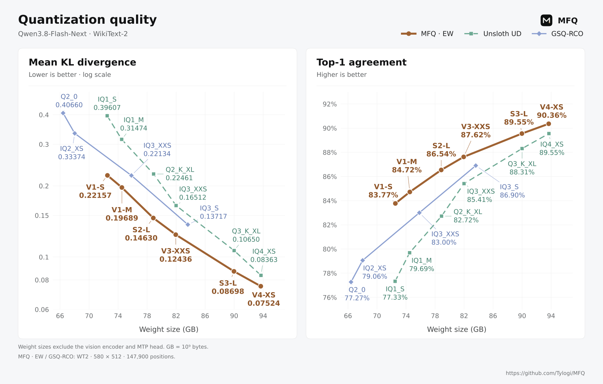
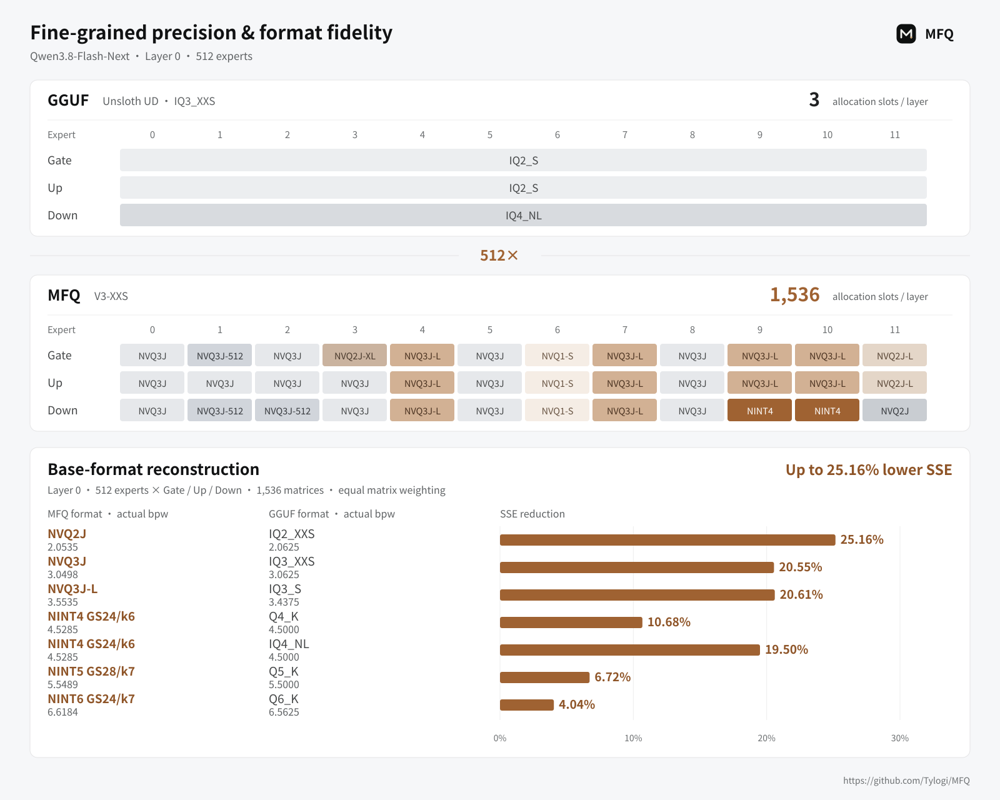
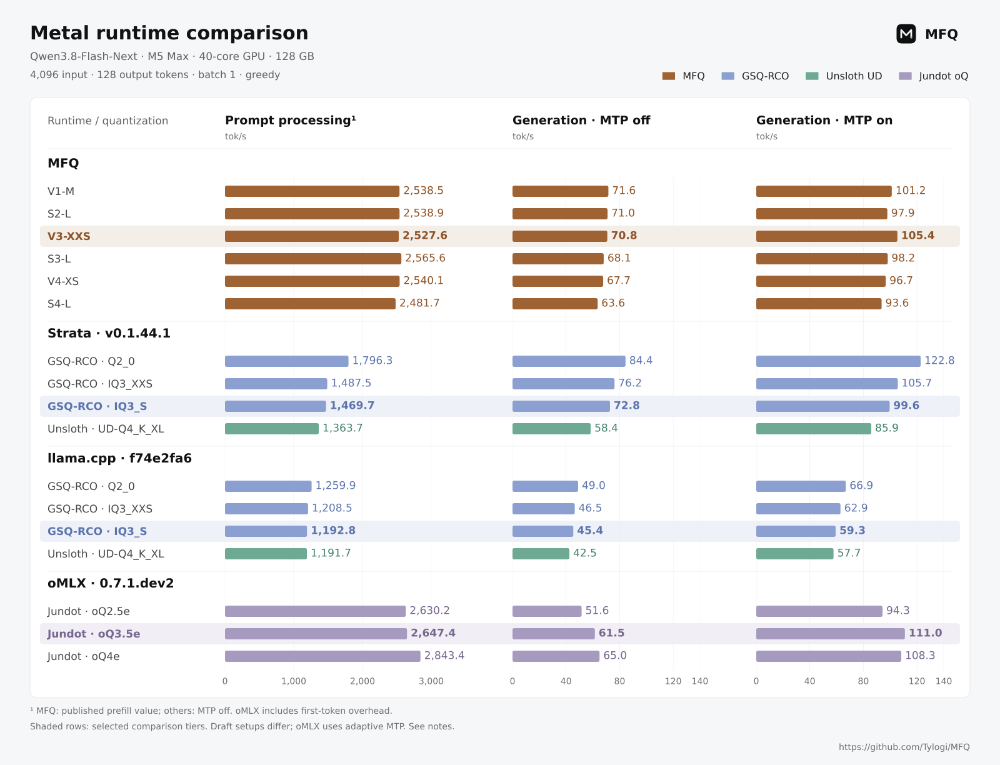
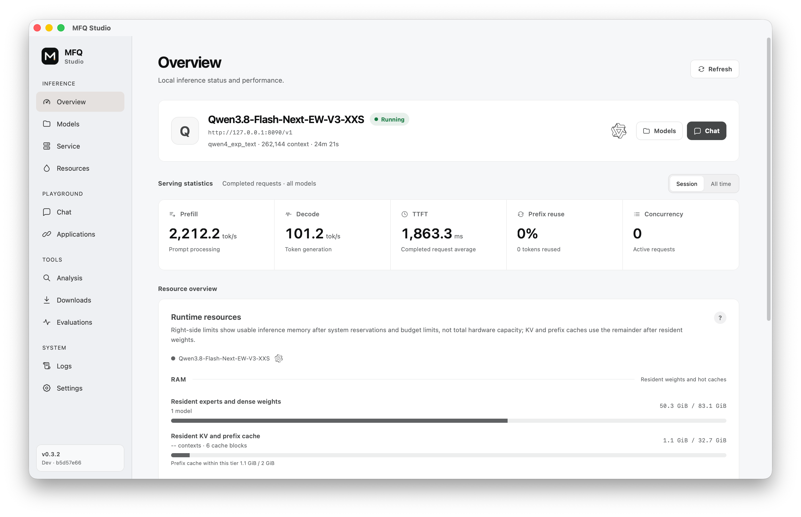
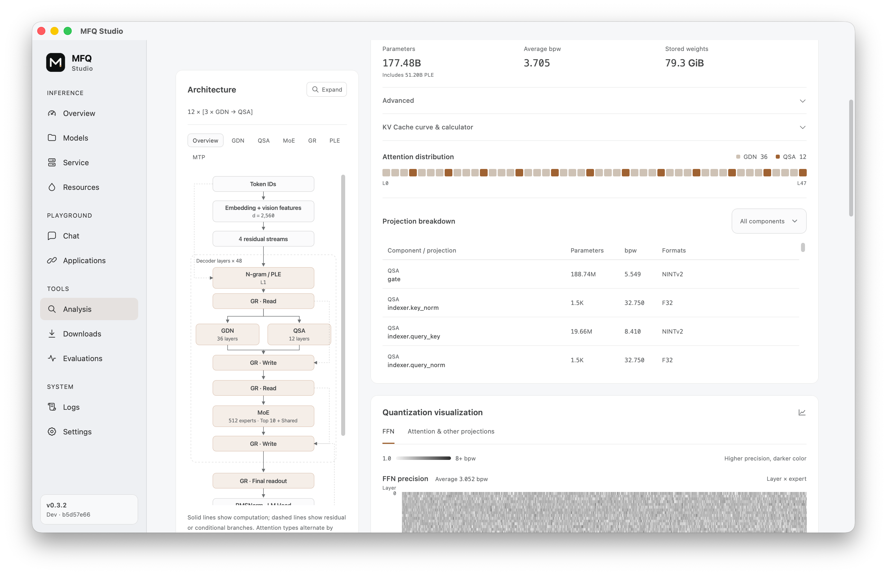

<div align="center">

# MFQ

<picture>
  <source media="(prefers-color-scheme: dark)" srcset="./docs/figures/tylogi-ai-lab-lockup-dark.svg">
  
</picture>

### High-fidelity quantization and local inference

**Every Bit. Maximum Fidelity.**

MFQ is a quantization and inference system for running large models on local
hardware. It co-designs fine-grained mixed-precision calibration, compact weight
formats, and native CUDA/Metal runtimes to preserve model quality within your
memory, storage, and latency budgets. Download and run models in **MFQ Studio**,
or connect applications and agents through OpenAI- and Anthropic-compatible APIs.

<p>
  
  
  
</p>

<p>
  <strong>English</strong> · <a href="./README.zh-CN.md">中文</a>
</p>

<p>
  <a href="#results">Results</a> ·
  <a href="#why-mfq">Why MFQ</a> ·
  <a href="#quick-start">Quick start</a> ·
  <a href="#models">Models</a> ·
  <a href="#benchmarks">Benchmarks</a> ·
  <a href="./docs/README.md">Documentation</a>
</p>

</div>

<a id="results"></a>

## Results at a glance

The following results use **Qwen3.8-Flash-Next**, with the model tier and
measurement conditions shown for each result.

| What matters | Measured result | Configuration |
| --- | --- | --- |
| Quantization quality | **37.4% lower KLD**; Top1 agreement **up 5.03 percentage points** | V1-M vs. Unsloth UD IQ1_M on WikiText-2, at approximately 74.5 GB weight size |
| Weight residency | **43.36 GiB resident weights** | V1-M on Metal, with the PLE table read from SSD |
| Apple / Metal generation | **101.2 tok/s** | V1-M; M5 Max, 40-core GPU, 128 GB; 4,096-token input; MTP enabled |
| NVIDIA / CUDA generation | **87.0 tok/s** | V1-S; RTX 3090 Ti + 32 GiB RAM; 4,096-token input; MTP enabled |

Weight residency excludes KV cache and runtime allocations. Full speed and
quality measurements are in [Benchmarks](#benchmarks).

The quality comparison below shows model size against agreement with the
reference model: lower KL divergence (KLD) and higher Top1 agreement are better.

<p align="center">
  
</p>

Quality-comparison weight sizes exclude the vision encoder and MTP head;
GB = 10⁹ bytes. See the [model card](https://huggingface.co/Tylogi/Qwen3.8-Flash-Next-EW-MFQ)
for the full comparison and tier selection guide. The
[plot data](./docs/figures/data/qwen38-flash-next-quality.json) records all comparison points and their source.

<a id="features"></a>

## Why MFQ

### Preserve quality with fine-grained precision

MFQ assigns precision to individual experts, projections, chunks, or neurons,
retaining higher precision where the model needs it most. NINT scalar and NVQ
vector formats can coexist within the same layer, with independent choices for
each expert's Gate, Up and Down projections. The native runtimes execute these
mixed formats directly.

MFQ's base formats also reduce reconstruction error. Across the seven listed
MFQ/GGUF format pairs, mean SSE is **4.04%–25.16% lower** on the tested layer-0
expert matrices. The figure shows the actual bpw for each pair.

For **Qwen3.8-Flash-Next**, the packed expert tensors in the Unsloth UD
`IQ3_XXS` recipe select one GGUF format for each layer's Gate, Up and Down
projections. MFQ `V3-XXS` selects a profile for **each expert projection**:
**1,536 allocation slots per layer**, compared with **3** in that recipe.

<p align="center">
  
</p>

The allocation panels show **Qwen3.8-Flash-Next, layer 0, experts 0–11**. Colors identify
the selected profiles. Expert 9 uses **NVQ3J-L for Gate and Up** and **NINT4 for
Down**. The **512×** ratio compares allocation slots per layer for MFQ and this
GGUF recipe; GGUF block-level quantization parameters can still vary. See the
[allocation data and sources](./docs/figures/data/qwen38-flash-next-layer0-allocation.json).

The lower panel's SSE is the equally weighted mean across **1,536 matrices in
layer 0**: all 512 experts' Gate, Up and Down projections. Actual bpw differs
within each format pair. See the [format benchmark notes](./docs/benchmarks/qwen38-flash-next-base-format-sse.md)
for the complete SSE table and the [format data](./docs/figures/data/qwen38-flash-next-base-format-sse.json)
for the supplied values and their source.

<details>
<summary>Full-model precision heatmaps</summary>

These **Qwen3.8-Flash-Next V3-XXS** heatmaps show the overall expert average,
followed by Gate, Up and Down, on a shared color scale.

<p align="center">
  
</p>

</details>

Our calibration method is open source; see
[Beyond Expert Rankings: Contrast Calibration for Mixed-Precision MoE Quantization](https://arxiv.org/abs/2610.20353).
For BibTeX, see [Citation](#citation).

### Fine-grained precision, fast native inference

MFQ's native kernels make this granularity practical by grouping compatible
expert work while preserving each projection's selected format. The **V3-XXS**
tier shown above reaches **105.4 tok/s on M5 Max** and **61.0 tok/s on
RTX 3090 Ti + 32 GiB RAM**, with MTP enabled.

The chart compares MFQ, Strata, llama.cpp and oMLX on the same **M5 Max (40-core GPU,
128 GB)**, using **Qwen3.8-Flash-Next** and a **4,096-token Python-code input**.
Each runtime's tested quantization tiers are shown separately.

<p align="center">
  
</p>

Shading and bold labels mark **MFQ V3-XXS (82.0 GB)** and the selected
comparison tiers: **GSQ-RCO IQ3_S (83.6 GB)** and **Jundot oQ3.5e (about 93.9 GB)**.
IQ3_S has a similar weight size to V3-XXS; oQ3.5e is larger.
These weight sizes exclude the vision encoder and MTP head.
With MTP enabled, V3-XXS reaches **105.4 tok/s**, while IQ3_S reaches
**99.6 tok/s** in Strata and **59.3 tok/s** in llama.cpp.
oQ3.5e reaches **111.0 tok/s** in oMLX with adaptive MTP.

The MFQ source gives one prefill value per tier; all other prefill bars use
MTP-off measurements. oMLX uses the official macOS 26/27 DMG with native NAX
kernels and adaptive MTP; its prefill timing includes first-token overhead.
Quantization tiers, draft configurations and repeat counts differ. See the
[benchmark notes](./docs/benchmarks/qwen38-flash-next-metal-comparison.md)
for complete conditions and tables, and the
[comparison data](./docs/figures/data/qwen38-flash-next-metal-runtime-comparison.json)
for all published values and their sources.
For CUDA results and complete MFQ speed tables, see [Benchmarks](#benchmarks).

MFQ's Apple Metal backend is built on [MLX](https://github.com/ml-explore/mlx),
with a native C++ runtime and custom Metal kernels for MFQ quantization formats.

CUDA combines VRAM, system RAM and SSD to run models that exceed GPU memory
capacity. Metal supports bounded expert residency and SSD streaming for MoE
experts and PLE tables. CUDA and Metal kernels operate on the packed weights,
with optimized attention, caching and I/O.

Feature availability depends on the model and backend; see the
[runtime support matrix](./docs/runtime/support.md). ROCm/HIP support is in
development, and optimized CPU backends are planned.

### Download, run, and serve from one app

**MFQ Studio** brings model downloads, loading, memory budgets, quantization
inspection and benchmarks into one desktop app. MFQ Server exposes OpenAI- and
Anthropic-compatible APIs for applications and agents. It manages multiple
models with LRU eviction and stores prefix and KV caches across RAM and SSD.
Continuous batching is available on supported native paths.

## Quick start

### Run a published model with MFQ Studio

1. Download **MFQ Studio** from [Releases](https://github.com/Tylogi/MFQ/releases).
   The package includes the desktop app, MFQ Server and native runtime.
2. Get a model from **Downloads**, then load it from **Models**. You can also
   open an existing local `.mfq` checkpoint.
3. Use the loaded model locally or connect an application through the compatible
   APIs. No source build is needed.

**Serving overview**

<p align="center">
  
</p>

**Quantization analysis**

MFQ Studio's built-in quantization visualization makes it easy to explore
the precision allocation of any MoE checkpoint, with detailed views across
layers, experts, and individual Gate, Up and Down projections.

<p align="center">
  
</p>

### Build from source

MFQ requires Git, [uv](https://docs.astral.sh/uv/), CMake 3.26+, and a
C++ toolchain. Use CUDA 12+ on NVIDIA systems or Metal on Apple silicon.
On Apple silicon, replace `uv sync` below with `uv sync --extra metal`.

```bash
git clone https://github.com/Tylogi/MFQ.git MFQ
cd MFQ

uv sync
uv run mfq build --backend auto
uv run mfq serve
```

Open <http://127.0.0.1:8090/> to load a model. To load an existing checkpoint
at startup, use `uv run mfq serve --model /models/model.mfq`.

Custom build options are in [`mfq build`](./docs/cli/build.md), and prebuilt
worker configuration is in [`mfq serve`](./docs/cli/serve.md).
Experimental AMD builds require ROCm 6+; see the
[HIP validation notes](./docs/runtime/hip-validation.md).

<a id="quantize-and-run-a-model"></a>

### Quantize your own model

For an HF Safetensors checkpoint, start with the **`S4-M` mixed-precision
preset**. It keeps sensitive tensors at higher precision and leaves vision and
MTP components at source precision by default.

```bash
# On Apple silicon, use: uv sync --extra metal --extra train
uv sync --extra train

# Hugging Face safetensors -> self-contained MFQ
uv run mfq quantize \
  /models/Qwen3.8-27B \
  /models/Qwen3.8-27B-MFQ-S4-M.mfq \
  --preset S4-M \
  --backend auto

# Load and serve the quantized model
uv run mfq serve \
  --model /models/Qwen3.8-27B-MFQ-S4-M.mfq \
  --context-size 32768
```

The quantizer also supports full-precision MFQ and GGUF sources, per-tensor or
Expert-Wise precision maps, activation importance matrices, and sharded output. See
[`mfq quantize`](./docs/cli/quantize.md) and
[`mfq calibrate`](./docs/cli/calibrate.md).

## Models

Published `.mfq` models are available from
[Hugging Face](https://huggingface.co/Tylogi) and
[ModelScope](https://www.modelscope.cn/profile/Tylogi).

| Model | Published precision families | Download |
| --- | --- | --- |
| Qwen3.8-Flash-Next | `V1-S`, `V1-M`, `S2-L`, `V3-XXS`, `S3-L`, `V4-XS`, `S4-L`, `S5-L` | [Hugging Face](https://huggingface.co/Tylogi/Qwen3.8-Flash-Next-EW-MFQ) · [ModelScope](https://www.modelscope.cn/models/Tylogi/Qwen3.8-Flash-Next-EW-MFQ) |
| DeepSeek-V4-Flash-0731 | Expert-Wise `V2` tiers | [Hugging Face](https://huggingface.co/Tylogi/DeepSeek-V4-Flash-0731-EW-MFQ) · [ModelScope](https://www.modelscope.cn/models/Tylogi/DeepSeek-V4-Flash-0731-EW-MFQ) |
| Qwen3.8-27B | `V1`–`V4`, `S4`–`S6` tiers | [ModelScope](https://www.modelscope.cn/models/Tylogi/Qwen3.8-27B-MFQ) |
| MiniCPM-o 4.5 | `S4`–`S8` multimodal tiers | [ModelScope](https://www.modelscope.cn/models/Tylogi/MiniCPM-o-4_5-MFQ) |

<details>
<summary>Supported architectures and backends</summary>

| Architecture group | Backends |
| --- | --- |
| Qwen3.5–3.8 | CUDA C++, Metal C++, HIP C++ (dense models; in development) |
| Qwen Flash-Next / Qwen4-style | CUDA C++, Metal C++ |
| DeepSeek-V4-Flash Series | CUDA C++, Metal C++ |
| MiniCPM-o 4.5 | CUDA C++, Metal C++ |
| GLM5–5.3 | CUDA C++; Metal reference runtime |
| Gemma 4 | CUDA C++; Metal reference runtime |

</details>

See the [runtime support matrix](./docs/runtime/support.md) for details.

## Benchmarks

All measurements below use **Qwen3.8-Flash-Next**. Expand a table to compare
tiers; use the [model card](https://huggingface.co/Tylogi/Qwen3.8-Flash-Next-EW-MFQ)
to choose a tier for your memory and quality budget.

<details>
<summary>Inference speed: all measured tiers</summary>

### Apple / Metal

| Tier | RAM Usage | Device | Input Size | Prompt Processing | Generation (no MTP) | Generation (MTP) |
| :--- | ---: | :--- | ---: | ---: | ---: | ---: |
| [V1-M](https://huggingface.co/Tylogi/Qwen3.8-Flash-Next-EW-MFQ/tree/main/V1-M) | 43.36 GiB | Apple M5 Max · 40-core GPU · 128 GB | 4,096 tokens | 2,538.5 tok/s | 71.6 tok/s | 101.2 tok/s |
| [S2-L](https://huggingface.co/Tylogi/Qwen3.8-Flash-Next-EW-MFQ/tree/main/S2-L) | 47.41 GiB | Apple M5 Max · 40-core GPU · 128 GB | 4,096 tokens | 2,538.9 tok/s | 71.0 tok/s | 97.9 tok/s |
| [V3-XXS](https://huggingface.co/Tylogi/Qwen3.8-Flash-Next-EW-MFQ/tree/main/V3-XXS) | 50.33 GiB | Apple M5 Max · 40-core GPU · 128 GB | 4,096 tokens | 2,527.6 tok/s | 70.8 tok/s | 105.4 tok/s |
| [S3-L](https://huggingface.co/Tylogi/Qwen3.8-Flash-Next-EW-MFQ/tree/main/S3-L) | 57.95 GiB | Apple M5 Max · 40-core GPU · 128 GB | 4,096 tokens | 2,565.6 tok/s | 68.1 tok/s | 98.2 tok/s |
| [V4-XS](https://huggingface.co/Tylogi/Qwen3.8-Flash-Next-EW-MFQ/tree/main/V4-XS) | 61.48 GiB | Apple M5 Max · 40-core GPU · 128 GB | 4,096 tokens | 2,540.1 tok/s | 67.7 tok/s | 96.7 tok/s |
| [S4-L](https://huggingface.co/Tylogi/Qwen3.8-Flash-Next-EW-MFQ/tree/main/S4-L) | 78.25 GiB | Apple M5 Max · 40-core GPU · 128 GB | 4,096 tokens | 2,481.7 tok/s | 63.6 tok/s | 93.6 tok/s |

### NVIDIA / CUDA

| Tier | RAM Usage | Device | Input Size | Prompt Processing | Generation (no MTP) | Generation (MTP) |
| :--- | ---: | :--- | ---: | ---: | ---: | ---: |
| [V1-S](https://huggingface.co/Tylogi/Qwen3.8-Flash-Next-EW-MFQ/tree/main/V1-S) | ≈41.04 GiB | 3090Ti + 32GiB RAM | 4,096 tokens | 1,779.7 tok/s | 62.9 tok/s | 87.0 tok/s |
| [V1-M](https://huggingface.co/Tylogi/Qwen3.8-Flash-Next-EW-MFQ/tree/main/V1-M) | ≈42.90 GiB | 3090Ti + 32GiB RAM | 4,096 tokens | 1,787.2 tok/s | 63.4 tok/s | 77.5 tok/s |
| [S2-L](https://huggingface.co/Tylogi/Qwen3.8-Flash-Next-EW-MFQ/tree/main/S2-L) | ≈46.93 GiB | 3090Ti + 32GiB RAM | 4,096 tokens | 1,707.8 tok/s | 58.8 tok/s | 77.8 tok/s |
| [V3-XXS](https://huggingface.co/Tylogi/Qwen3.8-Flash-Next-EW-MFQ/tree/main/V3-XXS) | ≈49.81 GiB | 3090Ti + 32GiB RAM | 4,096 tokens | 1,626.2 tok/s | 51.7 tok/s | 61.0 tok/s |
| [S3-L](https://huggingface.co/Tylogi/Qwen3.8-Flash-Next-EW-MFQ/tree/main/S3-L) | ≈57.28 GiB | 3090Ti + 64GiB RAM | 4,096 tokens | 1,408.5 tok/s | 39.4 tok/s | 42.1 tok/s |
| [V4-XS](https://huggingface.co/Tylogi/Qwen3.8-Flash-Next-EW-MFQ/tree/main/V4-XS) | ≈60.72 GiB | 3090Ti + 64GiB RAM | 4,096 tokens | 1,317.1 tok/s | 36.0 tok/s | 36.2 tok/s |

The PLE table stays on SSD; it does not need to occupy resident memory.
For example, V1-M downloads 72.44 GiB, including 29.54 GiB of PLE, while its
resident weights occupy 43.36 GiB.

</details>

<details>
<summary>Quantization quality: all measured tiers</summary>

WikiText-2 evaluation: lower KLD is better; higher Top1 agreement with the
reference model is better.

| MFQ Tier | Weight size (GB) | KLD ↓ | Top1 agreement ↑ |
| --- | ---: | ---: | ---: |
| `V1-S` | 72.536 | 0.22157 | 83.77% |
| `V1-M` | 74.529 | 0.19689 | 84.72% |
| `S2-L` | 78.859 | 0.14630 | 86.54% |
| `V3-XXS` | 81.952 | 0.12436 | 87.62% |
| `S3-L` | 89.976 | 0.08698 | 89.55% |
| `V4-XS` | 93.672 | 0.07524 | 90.36% |

Weight sizes in this comparison exclude the vision encoder and MTP head;
GB = 10⁹ bytes. See [Results at a glance](#results) for the comparison plot.

</details>

## Documentation

- [Documentation index](./docs/README.md)
- [Build the C++ runtime](./docs/cli/build.md)
- [Quantize a model](./docs/cli/quantize.md)
- [Run MFQ Server](./docs/cli/serve.md)
- [HTTP API](./docs/api/http.md)
- [WebSocket and realtime API](./docs/api/websocket.md)
- [Runtime support](./docs/runtime/support.md)
- [MiniCPM-o 4.5 multimodal runtime](./docs/runtime/minicpmo45.md)
- [Contributing and architecture rules](./CONTRIBUTING.md)

## Citation

If you use MFQ in your research, please cite our
[paper on mixed-precision MoE calibration](https://arxiv.org/abs/2610.20353):

```bibtex
@misc{xie2026contrastcalibration,
  title         = {Beyond Expert Rankings: Contrast Calibration for Mixed-Precision {MoE} Quantization},
  author        = {Xie, Renjie and Yang, Juncheng and Hu, Aoting and Liang, Yan and
                   Zhang, Mingxi and Hong, Zheheng and Xu, Wei and Chen, Yanzhi},
  year          = {2026},
  eprint        = {2610.20353},
  archivePrefix = {arXiv},
  primaryClass  = {cs.LG},
  url           = {https://arxiv.org/abs/2610.20353}
}
```

## Acknowledgements

MFQ is deeply inspired by and has learned from
[llama.cpp](https://github.com/ggml-org/llama.cpp),
[oMLX](https://github.com/jundot/omlx),
[MLX](https://github.com/ml-explore/mlx),
[PyTorch](https://github.com/pytorch/pytorch),
[Transformers](https://github.com/huggingface/transformers), and
[Unsloth](https://github.com/unslothai/unsloth).

MFQ is licensed under the [Apache License 2.0](./LICENSE).
