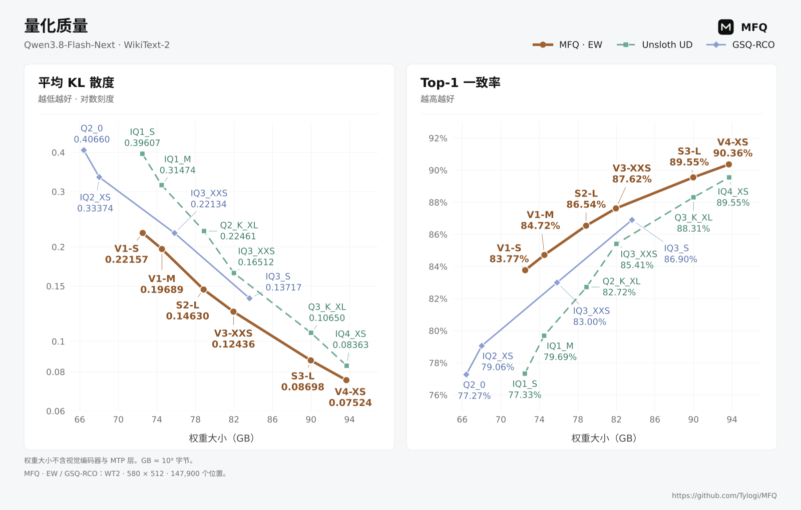
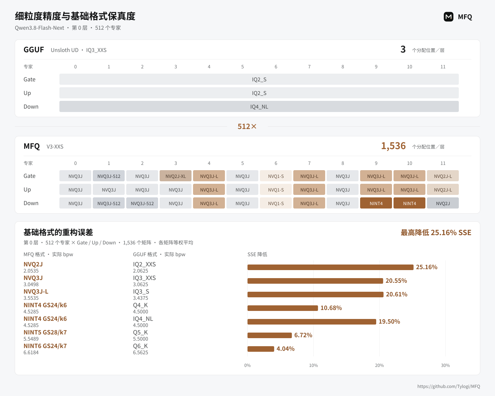
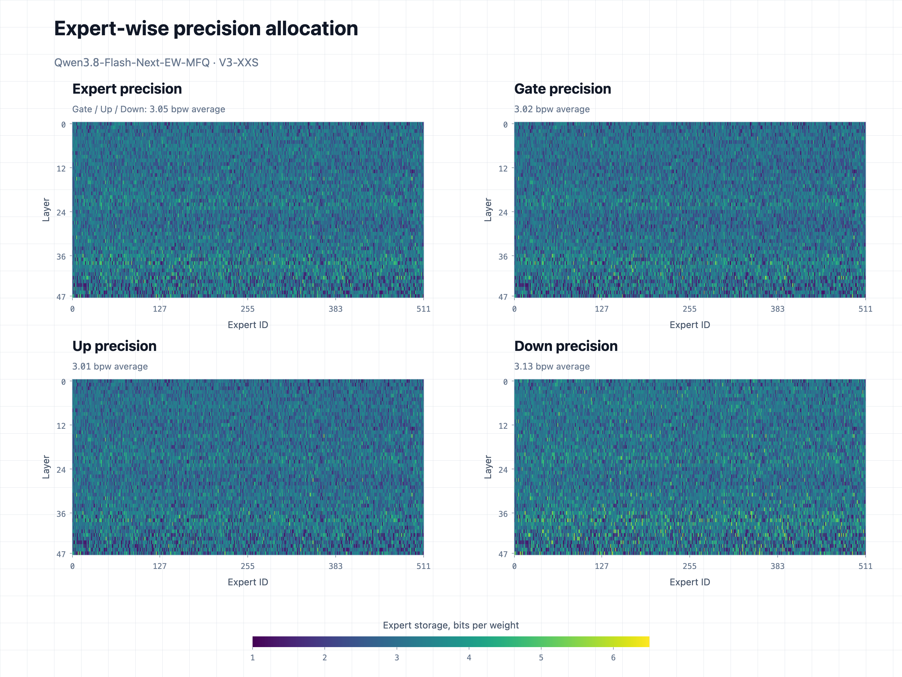
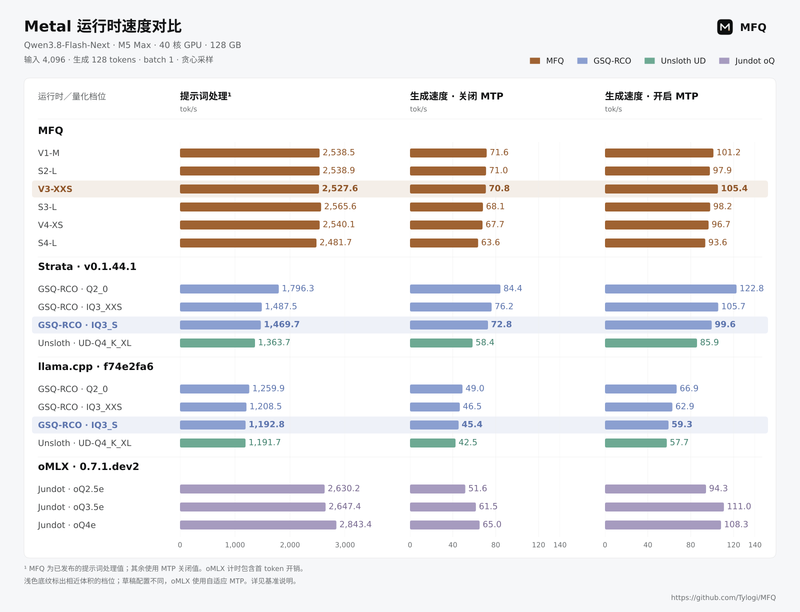
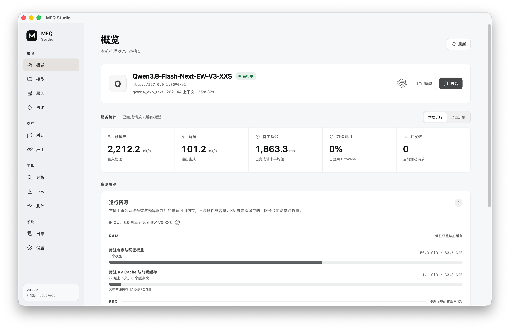
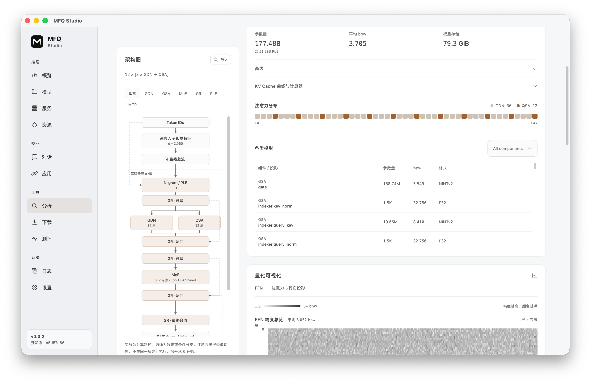

<div align="center">

# MFQ

<picture>
  <source media="(prefers-color-scheme: dark)" srcset="./docs/figures/tylogi-ai-lab-lockup-dark.svg">
  
</picture>

### 面向本地大模型的高保真量化与高效推理

**每一比特，极致保真。**

MFQ 是面向本地大模型的量化与推理系统。它联合设计细粒度混合精度校准、
压缩权重格式与原生 CUDA／Metal 运行时，在有限的内存、存储和延迟预算下
尽可能保留模型质量。你可以通过 **MFQ Studio** 下载和运行模型，也可以通过
OpenAI 和 Anthropic 兼容 API 接入应用与 Agent。

<p>
  
  
  
</p>

<p>
  <a href="./README.md">English</a> · <strong>中文</strong>
</p>

<p>
  <a href="#实测亮点">实测亮点</a> ·
  <a href="#为什么选择-mfq">为什么选择 MFQ</a> ·
  <a href="#快速开始">快速开始</a> ·
  <a href="#模型">模型</a> ·
  <a href="#性能与质量">性能与质量</a> ·
  <a href="./docs/README.md">文档</a>
</p>

</div>

## 实测亮点

以下结果均使用 **Qwen3.8-Flash-Next**，各项结果对应的模型档位与测量条件
列在表中。

| 关注点 | 实测结果 | 配置与条件 |
| --- | --- | --- |
| 量化质量 | **KLD 降低 37.4%**，**Top1 一致率提高 5.03 个百分点** | V1-M 与 Unsloth UD IQ1_M 对比；WikiText-2；权重大小约 74.5 GB |
| 权重常驻需求 | **43.36 GiB 常驻权重** | Metal 上的 V1-M，PLE 表按需从 SSD 读取 |
| Apple／Metal 生成速度 | **101.2 tok/s** | V1-M；M5 Max，40 核 GPU，128 GB；输入 4,096 tokens；开启 MTP |
| NVIDIA／CUDA 生成速度 | **87.0 tok/s** | V1-S；RTX 3090 Ti + 32 GiB RAM；输入 4,096 tokens；开启 MTP |

常驻权重大小不包含 KV Cache 与运行时的额外内存分配。各档位的完整速度和质量
数据见[性能与质量](#性能与质量)。

下图展示模型大小与参考模型一致性的关系：KL 散度（KLD）越低、Top1 一致率
越高，表示量化后的模型越接近参考模型。

<p align="center">
  
</p>

质量对比中的权重大小不含视觉编码器与 MTP 层，GB = 10⁹ 字节。
完整对比与档位选择建议见[模型卡](https://huggingface.co/Tylogi/Qwen3.8-Flash-Next-EW-MFQ)，
全部绘图数值与来源见[图表数据](./docs/figures/data/qwen38-flash-next-quality.json)。

<a id="功能特性"></a>

## 为什么选择 MFQ

### 用细粒度精度分配保留模型质量

MFQ 按专家、投影、Chunk 或神经元分配精度，让敏感权重保留更高精度。
同一层内可以混用 NINT 标量与 NVQ 向量格式，每个专家的 Gate、Up、Down
投影都能独立选择格式和精度，并由原生运行时直接执行。

MFQ 的基础格式也能降低重构误差：在图中列出的 7 组 MFQ/GGUF 格式对比中，
第 0 层专家矩阵的**平均 SSE 降低 4.04%–25.16%**。各组的实际 bpw 均在图中列出。

以 **Qwen3.8-Flash-Next** 为例，Unsloth UD `IQ3_XXS` 配方为每层的
Gate、Up、Down 打包专家张量各选择一种 GGUF 格式；MFQ `V3-XXS` 则为
**每个专家的每个投影**独立选择档位，每层有 **1,536 个分配位置**，
对应上述 GGUF 配方的 **3 个**。

<p align="center">
  
</p>

分配面板展示 **Qwen3.8-Flash-Next 第 0 层、专家 0–11** 的真实档位，颜色用于
区分所选格式。专家 9 的 **Gate、Up 使用
NVQ3J-L，Down 使用 NINT4**。**512 倍**指上述打包张量配方的分配位置之比，
GGUF 的块内量化参数仍可变化。具体分配与来源见[数据记录](./docs/figures/data/qwen38-flash-next-layer0-allocation.json)。

下方基础格式面板的 SSE 为**第 0 层全部 1,536 个矩阵的等权平均值**，覆盖
512 个专家的 Gate、Up、Down 投影。各对比格式的实际 bpw 相近，但存在差异。
完整 SSE 表格见[格式基准说明](./docs/benchmarks/qwen38-flash-next-base-format-sse.md)，
原始数值与来源见[格式数据](./docs/figures/data/qwen38-flash-next-base-format-sse.json)。

<details>
<summary>查看全模型精度热力图</summary>

下图以 **Qwen3.8-Flash-Next V3-XXS** 为例，依次展示专家平均精度以及
Gate、Up、Down 精度，四张热力图使用同一色阶。

<p align="center">
  
</p>

</details>

我们的校准方法已开源，详见论文
[Beyond Expert Rankings: Contrast Calibration for Mixed-Precision MoE Quantization](https://arxiv.org/abs/2610.20353)。
BibTeX 格式见[引用](#引用)。

### 细粒度精度分配，也能高效推理

为高效执行这些混合档位，MFQ 的原生内核将兼容的专家计算分组调度，同时保留
各投影所选的量化格式。上一张图中的 **V3-XXS** 档位在开启 MTP 时，生成速度达到
**M5 Max 上的 105.4 tok/s**，以及 **RTX 3090 Ti + 32 GiB RAM 上的
61.0 tok/s**。

下图对比 MFQ、Strata、llama.cpp 与 oMLX，均使用同一台 **M5 Max（40 核 GPU、128 GB）**，
运行 **Qwen3.8-Flash-Next**，输入为同一份 **4,096 tokens 的 Python 代码**。
各运行时按实际测试的量化档位分别展示。

<p align="center">
  
</p>

浅色底纹和加粗标注突出 **MFQ V3-XXS（82.0 GB）**，以及选作对比的
**GSQ-RCO IQ3_S（83.6 GB）** 和 **Jundot oQ3.5e（约 93.9 GB）**。
IQ3_S 与 V3-XXS 体积相近，oQ3.5e 更大；大小均不含视觉编码器与 MTP 层。
开启 MTP 时，V3-XXS 的生成速度为 **105.4 tok/s**，IQ3_S 在 Strata 和
llama.cpp 中分别为 **99.6 tok/s** 和 **59.3 tok/s**。
oQ3.5e 在 oMLX 中使用自适应 MTP，生成速度为 **111.0 tok/s**。

MFQ 来源表每档只给出一组提示词处理值，其余运行时的提示词处理柱均使用 MTP 关闭值。
oMLX 使用官方 macOS 26/27 DMG 内的原生 NAX 内核与自适应 MTP，
其提示词处理计时包含首 token 开销。
各组的量化档位、草稿配置和测量次数不同，完整条件与表格见
[基准说明](./docs/benchmarks/qwen38-flash-next-metal-comparison.md)，
全部已发布数值及来源见[对比数据](./docs/figures/data/qwen38-flash-next-metal-runtime-comparison.json)。
CUDA 结果与 MFQ 的完整速度表格见[性能与质量](#性能与质量)。

MFQ 的 Apple Metal 后端基于 [MLX](https://github.com/ml-explore/mlx)，
采用原生 C++ 运行时，并针对 MFQ 量化格式实现自定义 Metal 内核。

CUDA 侧联合使用 VRAM、RAM 和 SSD，运行超出显存容量的模型；Metal 侧支持
限制专家常驻量，并按需从 SSD 加载 MoE 专家与 PLE 表。CUDA 和 Metal 内核
直接处理打包权重，并针对注意力、缓存与 I/O 进行优化。

具体功能随模型与后端而异，详见[运行时支持矩阵](./docs/runtime/support.md)。
ROCm/HIP 支持仍在开发中，优化的 CPU 后端正在规划中。

### 在一个应用中下载、运行并提供模型服务

**MFQ Studio** 将模型下载、加载、内存预算、量化分析和测评整合到一个桌面
应用中。MFQ Server 通过 OpenAI 和 Anthropic 兼容 API 接入应用与 Agent。
服务端支持带 LRU 的多模型管理、RAM/SSD 分级前缀缓存与 KV Cache，并在
已支持的原生推理路径上提供连续批处理。

## 快速开始

### 用 MFQ Studio 运行已发布模型

1. 从 [Releases](https://github.com/Tylogi/MFQ/releases) 下载 **MFQ Studio**。
   安装包包含桌面应用、MFQ Server 和原生运行时。
2. 在「下载」中获取模型，再从「模型」中加载，也可以直接打开已有的本地
   `.mfq` 检查点。
3. 在本地使用已加载的模型，或通过兼容 API 接入应用，全程无需从源码构建。

**服务概览**

<p align="center">
  
</p>

**量化分析**

MFQ Studio 原生集成量化可视化功能，可直观、详细地查看任意 MoE 检查点的
精度分配，从各层、各专家一直细化到 Gate、Up、Down 投影。

<p align="center">
  
</p>

### 从源码构建

MFQ 需要 Git、[uv](https://docs.astral.sh/uv/)、CMake 3.26+ 和 C++ 工具链。
NVIDIA 平台使用 CUDA 12+，Apple 芯片使用 Metal。在 Apple 芯片上，请将
下面的 `uv sync` 换成 `uv sync --extra metal`。

```bash
git clone https://github.com/Tylogi/MFQ.git MFQ
cd MFQ

uv sync
uv run mfq build --backend auto
uv run mfq serve
```

打开 <http://127.0.0.1:8090/> 加载模型。若需在启动时加载已有检查点，可使用
`uv run mfq serve --model /models/model.mfq`。

自定义构建选项见 [`mfq build`](./docs/cli/build.md)，预编译 worker 的配置见
[`mfq serve`](./docs/cli/serve.md)。AMD 平台的实验性构建需要 ROCm 6+，详见
[HIP 验证记录](./docs/runtime/hip-validation.md)。

<a id="量化并运行模型"></a>

### 量化自己的模型

对于 HF Safetensors 检查点，可以从 **`S4-M` 混合精度预设** 开始。
它会为敏感张量保留更高精度，并默认保持视觉和 MTP 组件的源精度。

```bash
# Apple 芯片请使用：uv sync --extra metal --extra train
uv sync --extra train

# Hugging Face safetensors -> 自包含 MFQ
uv run mfq quantize \
  /models/Qwen3.8-27B \
  /models/Qwen3.8-27B-MFQ-S4-M.mfq \
  --preset S4-M \
  --backend auto

# 加载量化后的模型并启动服务
uv run mfq serve \
  --model /models/Qwen3.8-27B-MFQ-S4-M.mfq \
  --context-size 32768
```

MFQ 还可以量化满精度 MFQ 和 GGUF 源模型，读取逐张量或逐专家精度映射及激活
重要性矩阵，并输出分片模型。详见
[`mfq quantize`](./docs/cli/quantize.md) 和
[`mfq calibrate`](./docs/cli/calibrate.md)。

## 模型

已发布的 `.mfq` 模型可从
[Hugging Face](https://huggingface.co/Tylogi) 和
[ModelScope](https://www.modelscope.cn/profile/Tylogi) 下载。

| 模型 | 已发布精度系列 | 下载 |
| --- | --- | --- |
| Qwen3.8-Flash-Next | `V1-S`、`V1-M`、`S2-L`、`V3-XXS`、`S3-L`、`V4-XS`、`S4-L`、`S5-L` | [Hugging Face](https://huggingface.co/Tylogi/Qwen3.8-Flash-Next-EW-MFQ) · [ModelScope](https://www.modelscope.cn/models/Tylogi/Qwen3.8-Flash-Next-EW-MFQ) |
| DeepSeek-V4-Flash-0731 | 逐专家 `V2` 档位 | [Hugging Face](https://huggingface.co/Tylogi/DeepSeek-V4-Flash-0731-EW-MFQ) · [ModelScope](https://www.modelscope.cn/models/Tylogi/DeepSeek-V4-Flash-0731-EW-MFQ) |
| Qwen3.8-27B | `V1`–`V4`、`S4`–`S6` 档位 | [ModelScope](https://www.modelscope.cn/models/Tylogi/Qwen3.8-27B-MFQ) |
| MiniCPM-o 4.5 | `S4`–`S8` 多模态档位 | [ModelScope](https://www.modelscope.cn/models/Tylogi/MiniCPM-o-4_5-MFQ) |

<details>
<summary>支持的架构与后端</summary>

| 架构系列 | 后端 |
| --- | --- |
| Qwen3.5–3.8 | CUDA C++、Metal C++、HIP C++（稠密模型，开发中） |
| Qwen Flash-Next / Qwen4 风格 | CUDA C++、Metal C++ |
| DeepSeek-V4-Flash Series | CUDA C++、Metal C++ |
| MiniCPM-o 4.5 | CUDA C++、Metal C++ |
| GLM5–5.3 | CUDA C++；Metal 参考运行时 |
| Gemma 4 | CUDA C++；Metal 参考运行时 |

</details>

详细支持范围见[运行时支持矩阵](./docs/runtime/support.md)。

## 性能与质量

以下测量均使用 **Qwen3.8-Flash-Next**。展开表格可比较各档位，也可以参考
[模型卡](https://huggingface.co/Tylogi/Qwen3.8-Flash-Next-EW-MFQ)，按内存与
质量预算选择档位。

<details>
<summary>推理速度：各档位完整测量</summary>

### Apple／Metal

| 档位 | 内存占用 | 设备 | 输入长度 | 提示词处理 | 生成（无 MTP） | 生成（MTP） |
| :--- | ---: | :--- | ---: | ---: | ---: | ---: |
| [V1-M](https://huggingface.co/Tylogi/Qwen3.8-Flash-Next-EW-MFQ/tree/main/V1-M) | 43.36 GiB | Apple M5 Max · 40 核 GPU · 128 GB | 4,096 tokens | 2,538.5 tok/s | 71.6 tok/s | 101.2 tok/s |
| [S2-L](https://huggingface.co/Tylogi/Qwen3.8-Flash-Next-EW-MFQ/tree/main/S2-L) | 47.41 GiB | Apple M5 Max · 40 核 GPU · 128 GB | 4,096 tokens | 2,538.9 tok/s | 71.0 tok/s | 97.9 tok/s |
| [V3-XXS](https://huggingface.co/Tylogi/Qwen3.8-Flash-Next-EW-MFQ/tree/main/V3-XXS) | 50.33 GiB | Apple M5 Max · 40 核 GPU · 128 GB | 4,096 tokens | 2,527.6 tok/s | 70.8 tok/s | 105.4 tok/s |
| [S3-L](https://huggingface.co/Tylogi/Qwen3.8-Flash-Next-EW-MFQ/tree/main/S3-L) | 57.95 GiB | Apple M5 Max · 40 核 GPU · 128 GB | 4,096 tokens | 2,565.6 tok/s | 68.1 tok/s | 98.2 tok/s |
| [V4-XS](https://huggingface.co/Tylogi/Qwen3.8-Flash-Next-EW-MFQ/tree/main/V4-XS) | 61.48 GiB | Apple M5 Max · 40 核 GPU · 128 GB | 4,096 tokens | 2,540.1 tok/s | 67.7 tok/s | 96.7 tok/s |
| [S4-L](https://huggingface.co/Tylogi/Qwen3.8-Flash-Next-EW-MFQ/tree/main/S4-L) | 78.25 GiB | Apple M5 Max · 40 核 GPU · 128 GB | 4,096 tokens | 2,481.7 tok/s | 63.6 tok/s | 93.6 tok/s |

### NVIDIA／CUDA

| 档位 | 内存占用 | 设备 | 输入长度 | 提示词处理 | 生成（无 MTP） | 生成（MTP） |
| :--- | ---: | :--- | ---: | ---: | ---: | ---: |
| [V1-S](https://huggingface.co/Tylogi/Qwen3.8-Flash-Next-EW-MFQ/tree/main/V1-S) | ≈41.04 GiB | 3090Ti + 32GiB RAM | 4,096 tokens | 1,779.7 tok/s | 62.9 tok/s | 87.0 tok/s |
| [V1-M](https://huggingface.co/Tylogi/Qwen3.8-Flash-Next-EW-MFQ/tree/main/V1-M) | ≈42.90 GiB | 3090Ti + 32GiB RAM | 4,096 tokens | 1,787.2 tok/s | 63.4 tok/s | 77.5 tok/s |
| [S2-L](https://huggingface.co/Tylogi/Qwen3.8-Flash-Next-EW-MFQ/tree/main/S2-L) | ≈46.93 GiB | 3090Ti + 32GiB RAM | 4,096 tokens | 1,707.8 tok/s | 58.8 tok/s | 77.8 tok/s |
| [V3-XXS](https://huggingface.co/Tylogi/Qwen3.8-Flash-Next-EW-MFQ/tree/main/V3-XXS) | ≈49.81 GiB | 3090Ti + 32GiB RAM | 4,096 tokens | 1,626.2 tok/s | 51.7 tok/s | 61.0 tok/s |
| [S3-L](https://huggingface.co/Tylogi/Qwen3.8-Flash-Next-EW-MFQ/tree/main/S3-L) | ≈57.28 GiB | 3090Ti + 64GiB RAM | 4,096 tokens | 1,408.5 tok/s | 39.4 tok/s | 42.1 tok/s |
| [V4-XS](https://huggingface.co/Tylogi/Qwen3.8-Flash-Next-EW-MFQ/tree/main/V4-XS) | ≈60.72 GiB | 3090Ti + 64GiB RAM | 4,096 tokens | 1,317.1 tok/s | 36.0 tok/s | 36.2 tok/s |

PLE 表按需从 SSD 读取，无需常驻内存。例如，V1-M 下载大小为 72.44 GiB，
其中 PLE 表占 29.54 GiB，实际常驻权重为 43.36 GiB。

</details>

<details>
<summary>量化质量：各档位完整测量</summary>

WikiText-2 评测：KLD 越低越好，与参考模型的 Top1 一致率越高越好。

| MFQ 档位 | 权重大小（GB） | KLD ↓ | Top1 一致率 ↑ |
| --- | ---: | ---: | ---: |
| `V1-S` | 72.536 | 0.22157 | 83.77% |
| `V1-M` | 74.529 | 0.19689 | 84.72% |
| `S2-L` | 78.859 | 0.14630 | 86.54% |
| `V3-XXS` | 81.952 | 0.12436 | 87.62% |
| `S3-L` | 89.976 | 0.08698 | 89.55% |
| `V4-XS` | 93.672 | 0.07524 | 90.36% |

本项质量对比中的权重大小不含视觉编码器与 MTP 层，GB = 10⁹ 字节。
对比曲线见[实测亮点](#实测亮点)。

</details>

## 文档

- [文档索引](./docs/README.md)
- [构建 C++ 运行时](./docs/cli/build.md)
- [量化模型](./docs/cli/quantize.md)
- [运行 MFQ Server](./docs/cli/serve.md)
- [HTTP API](./docs/api/http.md)
- [WebSocket 与实时 API](./docs/api/websocket.md)
- [运行时支持范围](./docs/runtime/support.md)
- [MiniCPM-o 4.5 多模态运行时](./docs/runtime/minicpmo45.md)
- [贡献指南与架构规范](./CONTRIBUTING.md)

## 引用

如果你在研究中使用 MFQ，欢迎引用我们的
[混合精度 MoE 校准论文](https://arxiv.org/abs/2610.20353)：

```bibtex
@misc{xie2026contrastcalibration,
  title         = {Beyond Expert Rankings: Contrast Calibration for Mixed-Precision {MoE} Quantization},
  author        = {Xie, Renjie and Yang, Juncheng and Hu, Aoting and Liang, Yan and
                   Zhang, Mingxi and Hong, Zheheng and Xu, Wei and Chen, Yanzhi},
  year          = {2026},
  eprint        = {2610.20353},
  archivePrefix = {arXiv},
  primaryClass  = {cs.LG},
  url           = {https://arxiv.org/abs/2610.20353}
}
```

## 致谢

MFQ 深受以下项目启发，并从中学习：
[llama.cpp](https://github.com/ggml-org/llama.cpp)、
[oMLX](https://github.com/jundot/omlx)、
[MLX](https://github.com/ml-explore/mlx)、
[PyTorch](https://github.com/pytorch/pytorch)、
[Transformers](https://github.com/huggingface/transformers) 和
[Unsloth](https://github.com/unslothai/unsloth)。

MFQ 使用 [Apache License 2.0](./LICENSE) 许可证。
