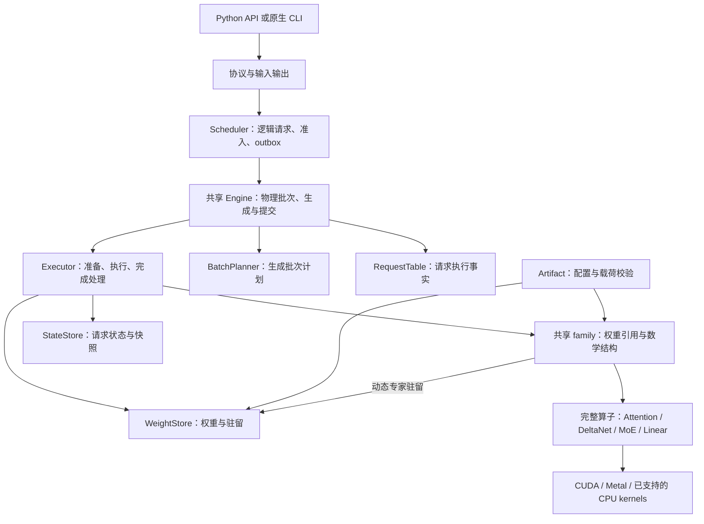

# MFQ 推理引擎重设计提案

范围：多模型、多算子的公共推理架构。

采用 **共享执行流程、共享模型组合、完整算子、显式资源所有权**。保留 `Runtime = Transport + Scheduler + Engine`，彻底替换 `CausalModelBase → CudaCausalOps → native model` 的继承/绑定链。公共层拥有实际行为，各后端提供数值算法、物理存储和设备执行；公共设计必须能用于不同后端，不能退化成统一接口后面的两套引擎。

本文只描述目标设计，不等于现状。四份文档的分工：[architecture.md](architecture.md) 记录当前实际架构与过渡限制，本文记录目标架构，[plan.md](plan.md) 记录从现状到目标的实施顺序、消费者迁移与验收门槛，[bugs.md](bugs.md) 是已知缺陷账本。本文的目录、依赖方向和所有权是终态要求；实施进度只以 plan.md 为准。

## 设计目标与范围

需要独立支持三个变化维度：

| 变化维度 | 例子 | 变化应集中在哪里 |
| --- | --- | --- |
| 模型数学结构 | GQA、GDN/KDA、MLA/稀疏注意力、HC、dense/MoE、视觉和音频 | 具体模型及拥有完整算法的算子模块 |
| 权重和状态表示 | NINT、NVQ、MX、FP8、MFE 内部分段、不同 KV 编码 | 载荷读取、状态存储和算子实现 |
| 执行方式 | prefill、decode、verify、batch、CUDA Graph、TP/EP、CPU/SSD offload | 执行器、算子内部实现选择和驻留管理 |

增加一个模型不应要求复制请求循环、采样、缓存事务和 batch 调度。增加一个量化格式不应修改所有模型的 forward。增加一种 attention kernel 不应改变模型数学定义。

默认一个 Engine 实例加载一个模型包；不同模型包可由不同实例运行，资源预算按设备汇总。不同权重的请求不混进同一物理 batch。模型包可以包含语言模型、predictor、视觉、音频和 TTS 子模型。

CUDA 是首个完整实现后端；Metal 必须用同一份 Engine 执行流程和 family forward 验证公共设计，放在核心 Interface 冻结之前。CPU 保留已有算子覆盖和 offload 用途，SSD 是存储层；不因此承诺一个完整 CPU 推理后端。

各后端的模型、格式和执行能力可以不同，按实际加载与验证结果公布。公共语义相同不意味着所有功能都支持，也不要求 CUDA 与 Metal 使用相同物理布局或产生逐位相同的浮点结果。Metal 现有独立实现是迁移起点，不作为最终双实现的理由。

本次不引入新语言、通用编译器、动态插件发现或分布式服务框架。不要求旧 C++ 内部接口兼容；已有可运行功能应逐项迁移验收。

## 与其他文档的关系

| 文档 | 性质与本提案采用的约束 |
| --- | --- |
| [architecture.md](architecture.md) | 当前实际架构：Studio/Python/native 模块与数据流、当前 Engine 接口字段、CUDA 与 Metal 的实际差别、构建边界与过渡限制。本文给出目标架构与尚未落地的目录终态 |
| [plan.md](plan.md) | 实施顺序、逐阶段退出条件、消费者迁移与删除门槛。本文不重复这些内容 |
| [bugs.md](bugs.md) | 已知缺陷账本。架构性欠账在本文定义终态，在 bugs.md 登记状态，在 plan.md 安排落地 |
| [PYTHON_SIMPLIFICATION.md](../../docs/PYTHON_SIMPLIFICATION.md) | Python 职责约束。生产推理由 C++ worker 执行；Python 管协议、进程、量化与校准；不增加 Python 模型推理回退 |

当前实现（[architecture.md](architecture.md) §2）区分 Scheduler 的逻辑请求状态和 Engine 的物理执行状态，这个区分有必要。需要删除的是重复准入队列、独立生成循环和跨模块复制的可变事实；不能因为两层都按 RequestId 记录状态，就把整个 Scheduler 合入 Engine。

现有规范要求每个 family 的公式定义一次，这个目标也保留。要替换的是 `CausalModelBase → CudaCausalOps → native model` 的继承与绑定机制，以及只排列 callback 的共享模板。新的共享模型直接组合完整算子；CUDA/Metal 只提供原生类型与实际计算。

`Runtime` 仍指应用的装配和生命周期职责。结合 [CONTRIBUTING](../CONTRIBUTING.md) 的规定，不为这个名称另建 `runtime/` 目录或转发类。现有产物的旧名称与 schema 读取策略也不因删除 C++ Adapter 自动改变，格式迁移另行处理。

## 方案选择与抽象标准

| 方案 | 取舍 |
| --- | --- |
| 每个后端一套具体模型和执行流程 | CUDA 内容易扁平化，但后端增加时重复数学与生成规则，不满足公共设计目标 |
| 公共语义 IR 与编译执行器 | 能共享计算结构，但要新增 shape、alias、状态依赖、动态形状、融合和失效系统；现有 ModelGraph/GraphRegistry 不是现成计算 IR |
| 共享 C++ 模型组合 + 完整后端算子 | 共享实际模型与执行规则，原生类型可保留；本次采用，用两种模型和两个后端检验抽象 |

模板只用于替换完整实现和原生值类型，不用于继承内部成员、排列微小 callback 或给每个 family 再做一层绑定。保留一个面向 Scheduler 的 Engine 虚 Interface；内部采用具体类型和组合，不建设 Tensor/Model/Store 的虚基类体系。

按 codebase-design 的 Depth、Locality 和删除测试审查每个 Module：小 Interface 应隐藏完整行为，相关修改应集中。删掉一个模块后复杂度直接消失的转发层应删；算法、事务和资源管理删掉后复杂度散回调用方，应保留。纯规划函数也可以是深模块。

## 目标模块与所有权



图中的 Module 不要求各建一套虚基类。`EngineImpl<B>` 实现唯一公共 Engine Interface，组合共享的 RequestTable、Planner、StateStore、WeightStore、Executor 和模型集合。B 是编译期后端类型集合，不是保存全部资源并转发所有操作的对象。

五个 Module 的所有者是 Engine 实例；Executor 持有对 Store 的引用及取得的 lease，不能再次拥有同一份状态或预算。共享实现用模板组合原生存储/执行类型，后端只实现其中真实变化的部分。

| 对象 | 唯一所有者 | 生命周期与限制 |
| --- | --- | --- |
| 模型配置、层结构、只读权重引用 | 具体 Model | 随模型包存活；没有当前请求或 cache position |
| 准入、优先级、deadline、取消决定、逻辑 session 与输出队列 | Scheduler 的请求记录 | Scheduler loop 是唯一写入者；没有 Engine 内部准入队列 |
| prefill/decode/verify 阶段、token 历史、采样与解析进度 | 共享 Engine 的 ExecutionRequest | 按 RequestId 对应 admitted 请求；只由同一 loop 调用和推进 |
| KV、循环状态、卷积历史、稀疏索引及 predictor 状态 | StateStore | 请求持 lease；slot 带 generation；GPU 使用完成后才能回收 |
| workspace、stream、event、捕获图及固定输入缓冲 | Executor | 按设备和执行 slot 管理；并发执行不共享可写 scratch |
| 原始载荷、解码/重排缓存、专家驻留与传输缓冲 | WeightStore | 只读权重共享，驻留 slot 受 lease 和完成事件保护 |
| tokenizer、模板、输出解析 | Engine 的输入输出模块 | HTTP、CLI、诊断复用同一实现 |
| 原始名称映射、容器校验、文件范围读取 | Artifact | 加载时归一化；forward 不知道 HF/GGUF 别名 |

Model 保留不可变配置、层结构和只读权重引用。运行时 `max_context` 是执行限制，不再覆盖模型原始最大长度。对外 `ModelInfo` 是加载成功后生成的只读摘要；运行代码不把它当第二份可变配置。

`ArtifactManifest` 表达文件声明；运行时只保留所需身份信息和实际加载的对象。功能能力由加载结果、算子覆盖与状态能力共同生成，不再同时维护 graph、plan、指针和同义 available 布尔值。

### 模块边界的判定

独立 Module 的判据是 Depth、Locality 和删除测试：它是否用小 Interface 隐藏完整行为，相关变化是否集中，删除它之后复杂度是否重新散到调用方。有可变状态时，还必须明确修改权限、生命周期和回收条件；无状态的规划、格式校验和量化解码也可以是深模块。生命周期不同是需要分别管理的理由，不要求为每种生命周期建立一个独立类。

共享 Engine 负责阶段推进、采样与投机提交规则、输出解析和 typed result 构造，可以持有请求、session 索引、策略统计和健康状态；对外事件由 Scheduler 发布。下面五个 Module 是其主要职责分区，不要求 Engine 无状态，也不要求把所有内部类型硬塞进五个独立类。其中 BatchPlanner 是上图“物理批次”的规划部分；RequestTable 可先复用现有 ExecutionRequest 容器，避免仅为名称新增包装。

| Module | 职责与所管理的事实 | 存活期 | 修改权限 | 回收条件 |
| --- | --- | --- | --- | --- |
| RequestTable | prefill/decode/verify 阶段、token 历史、采样与解析进度 | 请求存活期 | 唯一 Scheduler loop 调用 Engine 更新 | 资源清理或转存完成，并返回 terminal 后 |
| BatchPlanner | 根据 eligible IDs、预算和状态快照生成 BatchPlan，不拥有准入队列 | 规划调用本身无须持久状态；已提交产物跨 step 存活 | Planner 构造计划，提交后保持不可变 | 未提交计划可丢弃；提交后的必要快照由 Preparation/InFlightBatch 保留至最后消费者完成 |
| StateStore | KV、循环状态、卷积历史、稀疏索引与 predictor 的存储、版本及恢复 | 跨 step，到请求释放或转为 session/prefix cache | 管理元数据经 StateStore 修改；数值内容由持写 lease 的算子修改 | 所有请求、cache、快照和 graph 的引用解除，且 I/O 与最后消费者完成 |
| WeightStore | 权重驻留位置、解码/重排缓存、专家 slot、传输缓冲 | 跨请求，到模型 reload 或缓存淘汰 | 管理元数据经 WeightStore 修改；载荷在准备完成后供算子只读 | 相关 lease/graph 引用解除，且 I/O 与最后消费者完成，方可淘汰或释放 |
| Executor | 数值任务、stream、event、workspace arena、捕获图及固定输入缓冲 | 按资源种类管理，跨一次或多次执行 | Executor 经对应资源 Interface 管理 | 按下表分别判定，slot 暂时空闲不足以证明可释放 |

BatchPlanner 可以实现为普通规划函数。BatchPlan 表达本次选择，Preparation/InFlightBatch 记录已提交工作的稳定快照和实际进度；保留这些记录不会产生第二套准入队列。MTP 接受率、耗时估计等跨 step 统计由请求记录或 Engine 内既有策略对象持有，Planner 读取它们，不能随一次规划销毁。

StateStore 与 WeightStore 实例由 Engine 唯一持有，Executor 借用它们。slot 分配、引用计数、generation、可见版本和驻留位置只能经 Store 的 Interface 修改；Executor 不直接写这些内部字段。对数值内容，StateStore 发放有版本和范围的写 lease，算子通过相应 view 更新 KV/recurrent 张量，同一 sequence 同时最多一个执行量持有写权限。只读共享前缀在写入前必须取得独占副本或满足对应写时复制契约。这里区分的是修改权限，不把 CPU 管理线程与实际 GPU 写入者混为一谈。

Executor 内部的资源按真实引用关系回收：

| 资源 | 复用或释放条件 |
| --- | --- |
| activation 与普通 scratch | 使用它们的任务和 I/O/设备消费者结束；如果被 graph 捕获，则同时满足 graph 引用条件 |
| InFlightBatch 与 coroutine frame | forward、sampling/verification、必要 replay、commit 或取消 drain 全部完成，再释放其持有的引用 |
| graph arena、固定输入/metadata 与权重绑定 | 维持缓存 graph 的地址契约；销毁或使关联 graph 失效、解除引用且最后一次 replay 完成后，才可释放或更换地址 |
| stream 与 event 池 | stream 可按队列顺序继续提交，并显式维护跨 stream 依赖；event 归还池前解除原有使用与等待依赖；销毁资源或重新分配独占执行 slot 前完成全部关联工作 |

三对需要分别明确职责的 Module：

| Module | 各自负责什么 |
| --- | --- |
| StateStore / WeightStore | 前者管理会推进、共享和回滚的请求状态；后者管理逻辑只读权重的加载与驻留。二者可复用底层 allocator/I/O，但不混用状态事务和权重淘汰规则 |
| StateStore / Executor | 前者管理模型状态及其版本，后者管理计算任务、执行资源与 graph。二者都有跨 step 资源，不能仅按存活时间划分 |
| RequestTable / BatchPlanner | 前者记录请求已经执行到哪里，后者根据这些事实决定下一批做什么。已提交 BatchPlan 的快照属于执行记录，不再参与独立准入或公平性决策 |

Module 可以按明确的 Interface 直接协作。共享 Engine 调用 Planner 并通过 Executor 执行计划；Executor 直接请求 StateStore 的预留、快照、物理提交/恢复和回收，以及 WeightStore 的驻留、传输与淘汰。共享 Engine 决定确认哪个前缀、何时发布结果和采用什么 session 策略，下层隐藏页、slot、stream 与 I/O 的具体协调，不要求 Engine 逐项转发这些操作。

Model 与普通算子接收显式 state/weight view。动态 MoE 的共享数值组合负责 routing → 等待专家驻留 → 专家计算 → 合并，通过 WeightStore 取得 lease，并调用后端数值算子。专家权重绑定保存稳定的专家集合身份与所属 WeightStore 的借用引用；模型不拥有缓存，也不复制驻留策略。I/O、传输和淘汰藏在驻留实现中；backend ops 只见准备好的原生 buffer/view，不回调上层 Store。

Store 不访问请求队列、不调用 Scheduler、不替代共享 Engine 的生成规则。需要异步等待的模型组合返回可推进任务；lease 由任务和 InFlightBatch 保持。普通算子不必经过通用资源服务定位器。include 方向见目录章节，运行期协作不授权反向依赖。

## 公共设计与后端实现的分工

| Module | 公共层实际拥有的行为 | 后端实现的真实差异 |
| --- | --- | --- |
| RequestTable | 请求阶段、token/采样/解析进度、唯一完成路径、生成与停止规则 | 不需要后端版本 |
| BatchPlanner | eligible 内选行、chunk、兼容性与预算约束；返回不可变计划 | 后端提供容量/执行约束的值快照，不提供另一套规划器 |
| StateStore | sequence 身份、版本、引用、独占写、session/prefix 索引、事务提交顺序 | 原生状态池、页/张量布局、copy/fork/checkpoint/restore 的物理实现 |
| WeightStore | 权重身份、驻留预算、lease、读取/传输状态、淘汰规则 | 权重 materialization、原生 buffer、传输与可用格式实现 |
| Executor | prepare/launch/poll/drain、在途事务、采样/重放/提交阶段的推进 | stream/command buffer、completion、workspace、Graph/编译执行等设备机制 |
| Model | family 配置、层结构、位置、残差、媒体及 predictor 的数学组合 | 完整算子实现与原生 Tensor 类型；不另写 family forward |

五个 Module 是功能分区，不要求五个虚 Interface、五个 library 或全部模板化。RequestTable 和 Planner 可直接复用非模板代码；Store 与 Executor 只有操作原生值的部分需要编译期参数。文本、模型和公共值契约仍有独立归属。

### 后端接入的三个位置

1. **完整算子**：Linear、Attention、DeltaNet、MoE 专家计算、采样等。Interface 包含数学语义、输入布局、状态读写范围、数值容差和 workspace 上限；每个实现真正拥有算法与分派。
2. **物理存储**：状态池、快照载荷、权重 materialization 与传输。公共 Store 持有具体实现，决定逻辑版本/可见性；后端不复制 session LRU、token 提交或缓存身份规则。
3. **设备执行**：提交、完成查询、执行资源和可选优化计划。公共 Executor 推进事务；后端不再维护请求表、准入队列或生成循环。

后端类型集合仅列这些完整实现的类型别名。只定义真实使用的能力，不让每个后端实现几十个空 hook；不支持的算子在构造时给出明确错误，可选 Graph 能力不存在时使用同一 eager 流程。类型选择集中在后端装配入口，公共实现不得出现 `is_cuda`、`is_metal`；通用请求、规划、Store 与执行流程不得出现 family 名称分支，模型定义和工厂可识别 family。

StateLayout/WeightDescriptor 等逻辑值可共享；Tensor、物理 page table、snapshot payload、device event 保持原生。通过显式类型把它们带过编译期 Seam，不加一套通用 type-erased Tensor/KV。

后端只实例化自己具备必要算子的模型集合；工厂在实例化集合之外明确拒绝不支持的 family。不能为凑齐同一个巨大 variant，要求 Metal 实现不存在的 CUDA 算子类型。已实例化模型内部的格式、形状与恢复能力仍在加载/准备时校验。

**单一所有权例子**：`StateStore<NativeStatePool>` 的 sequence 记录持有 NativeStatePool 发出的存储句柄。引用计数、slot generation 和缓存策略只有一份明确的所有者；backend pool 可管理物理分配引用，但不能再维护独立的逻辑请求版本。事务成功才发布共享可见游标，失败由同一 Store 失效或恢复。不能在两侧各建一张同义状态表再靠 Adapter 同步。

### 异步执行的公共契约

公共层观察 `pending / ready / failed` 等进度值，持有后端原生 completion；不读取 CUDA event 或 Metal command buffer 的内部状态。后端提交负责让必要输出和副作用进入实际执行，不能把“已构造惰性 Tensor”当作设备工作完成。

`poll` 只查询和推进有界工作，不等待整段生成；ready 必须覆盖输入消费、状态写入及需要的 host 可见结果。跨 stream/队列依赖和最后消费者由后端执行实现维护，并通过 completion 与 lease 告知公共 Executor。不同后端可以批量提交或延迟求值，不被强制每个算子同步。

取消由公共流程停止新推进，后端继续完成或排空已提交工作。只有 completion 满足回收契约后才销毁任务或复用存储。设备错误由后端报告影响范围，公共流程决定请求终止或实例失效，不在后端各写一套失败生命周期。

### 公共 Interface 如何证明有效

先让 CUDA 的 Qwen35 与结构不同的 DeepSeek 通过同一执行链，再让 Metal 的真实 Qwen 路径实例化同一 Engine、Model、事务与文本实现。允许 backend 数值/存储不同；不接受 Metal 转发到旧 MLX generation loop 来假装接入。

在此之前 Interface 可以随真实调用调整，不冻结成大型 framework。CPU fake 只验证规则，不能代替第二后端；跨后端设计需由真实第二后端验证。

## 请求生命周期与执行器

### 一个调度循环，逻辑与物理状态各有所有者

Transport 只向 Scheduler mailbox 提交 owned commands，并读取 Scheduler 管理的有界 outbox。Scheduler 负责准入、公平性、deadline 与取消决定，只调用 Engine 的普通方法。Engine 接收 eligible IDs，负责物理兼容性、batch packing、生成阶段和缓存事务；内部 Executor 不维护自己的准入队列或工作循环。

Python server 保留鉴权、服务管理、模型选择与公开协议，生产推理由 native worker 执行。保留现有 IPC，只在实际需要时改变传输方式。`docs/ipc.md` 中的 ZMQ、pickle 和进程拓扑是参考实现事实，不是本次新增依赖。原生 tokenizer/媒体准备可使用工作线程，结果由 Engine::step 轮询，不从工作线程调用 Scheduler 或 Transport。

两类状态分别表达不同事实：

```text
Scheduler: queued -> admitted/running -> terminal
                     output-blocked / cancelling

Engine:    preparing -> prefilling -> decoding/verifying
                                    -> terminalizing -> released
```

背压是 admitted 请求暂不 eligible 的条件。outbox 同时限制字节数和事件数，预留一个 terminal 的空间；取消和清理不受普通输出背压阻塞。每个请求恰好一个 terminal，之后没有事件。Engine 只有在请求资源释放完毕或转为 Engine 所有的 session cache 后才返回 terminal；设备尚未完成时可先停止新生成和普通输出交付，但不能提前宣告清理完成。

公共使用方式示意：

```cpp
auto engine = make_cuda_engine(model_path, options);
Scheduler scheduler(*engine);
auto request = scheduler.submit(input);
auto events = request.wait();       // 读取有界输出队列
scheduler.cancel(request.id());     // 命令进入同一 mailbox
```

应用负责装配和 loop 的生命周期，Transport 不持有 Engine 引用。阻塞式离线调用驱动同一 step/result 契约，不另写 generate。诊断可直接调用具体 Engine；生产和测试都在计算返回后处理 typed results。

Engine 对外继续提供 `info/admit/cancel/step/status/session/reload` 这些有实际职责的方法。`EngineImpl<CudaBackend>` 与 `EngineImpl<MetalBackend>` 实例化同一个共享实现并直接实现 Engine Interface，不再套逐方法转发的 facade。这里的类型名是示意，不要求保留现有模板内部结构。

### 对外契约、线程与禁止的模式

以下约束在当前实现里可核对（[architecture.md](architecture.md) §2 列出实际接口与字段），目标设计继续逐条沿用；只有内部实现方式会变。

`EngineRequest` 只含 owned 的后端中立值或稳定媒体句柄：请求与逻辑 session ID、规范化文本/chat 输入与媒体描述、采样/生成/约束/输出选项、cache 复用意图、执行安全点需要的 deadline 元数据。它不含协议对象、响应 writer、callback、后端 Tensor 或借用的 transport 内存。

`EngineStepResult` 是 owned 值：推进、仍 blocked、到达 terminal 或已释放的 ID，按发布顺序排列的 typed 请求事件，更新后的 capacity 与后端健康，是否仍有可执行或在途工作，以及异步后端工作的下次唤醒 deadline。事件是闭合的 typed variant：

```text
PrefillProgress
OutputDelta       { token_ids, text, reasoning, tool_delta }
UsageUpdate
Completed         { finish_reason, final_usage }
Cancelled         { final_usage }
Failed            { code, message, retryable }
```

投机解码在一次验证步里把所有 accepted token 放进一个有序 `OutputDelta`，不反复调 token callback。terminal 结果只有 completed、cancelled、rejected、failed 四种，幂等，terminal 后不再发布事件；Scheduler 见到 terminal 就可以丢弃自己的 admitted 状态，不需要另一个清理 callback。

线程约束不变：Transport 线程只投递命令和等待 outbox；一个 Scheduler loop 是同一 Engine 实例的唯一调用者，因此 Engine 不需要为来自自己 Scheduler 的调用加全局请求锁；stream、CUDA event、collective 与设备锁留在后端内部；CPU 准备工作线程的完成由 `Engine::step` 轮询或 drain 并以值返回，不回调 Scheduler；持有模型、cache、allocator 或设备状态锁时不执行外部代码；多个 Engine 实例拥有互不相交的模型、stream、cache、graph 状态与 Scheduler loop；TP/EP 的 rank 协调留在 Engine 后面。

失败模型：请求级失败作为 typed `Failed` 事件返回；全局后端故障只返回或抛出到 Scheduler loop，由它把每个受影响 admitted 请求恰好失败一次并把 Engine 转入 unhealthy。后端异常不得在持有设备锁时越进 transport worker。恢复可以重置后端物理状态，但不得重放已发布的 token；token 只在其模型/cache 事务提交后才可发布。

启动顺序：校验 Engine 配置 → 加载 Engine 与不可变能力 → 用该 Engine 构造 Scheduler → 启动 Scheduler loop → 启动 Transport 接收。reload 是 Scheduler 控制操作：停止准入 → 按策略 drain/cancel → 调 Engine reload → 刷新能力 → 恢复准入。shutdown 逆序：Transport 停止接收 → Scheduler 拒绝新命令并 cancel/drain → Engine 释放请求/cache/graph/stream/collective → Scheduler loop 退出 → Transport 关闭连接。

目标 runtime 不得出现：由公开 `std::function` 字段拼成的 Engine；`generate(..., on_token, on_prefill, cancelled)` 作为 Engine 边界；请求路径上的 token/prefill/completion/decode/output callback；用 callback 返回值表达 stop、取消或背压；把模型专属 decode 函数作为 runtime callback 注入共享循环；在持有模型/设备/cache 锁时调 callback；逐 token 同步生产者/消费者确认；为绕过已持有的模型锁而加的 dummy mutex；Scheduler 与 Engine 各自的重复准入队列或竞争 worker；后端独立的请求生命周期，或在共享 Engine Interface 后面复制整套 family forward；serial/batch/MTP 各自一套 stop 处理、公开输出、session 提交或 terminal 清理；Transport 直接配置或调用活动 Engine。局部 lambda 作为即时实现细节可以，但不得逃出栈帧、发布 runtime 输出或转移生命周期所有权。

### 每个执行量有明确上限

一次 step 先处理命令和 completion，再选择一个有界执行量：prompt chunk、decode batch、有限深度的验证，或一段媒体计算。执行器不能在一次 step 内跑完整个用户请求。

Scheduler 提供有序 eligible IDs 和准入约束。共享 Engine 根据 token、序列数、状态预算和物理兼容性生成 `BatchPlan`，实际采用的请求及新 capacity 随 step result 返回。Executor 的 prepare 预留状态、workspace、权重 staging 和结果空间；不足时释放本次未提交预留并返回 deferred/unsupported，由 Engine 缩小物理批次或等待，优先级仍由 Scheduler 决定。

Scheduler 同时提供并预留每个请求本次可用的输出字节/事件额度，直到结果入队或执行取消后归还。Engine 据此限制 MTP depth 和媒体 chunk；估算必须包含 token ID、解码文本、parser 待发布内容及媒体载荷，不能仅检查 outbox 是否尚未满。MTP 为完整 accepted-token delta 预留空间；媒体使用有界 chunk。若需 pending result，其内存也计入同一额度，不能另建无界缓冲。terminal 的保留空间不参与普通输出额度。

内部 Interface 示意：

```cpp
Preparation prepare(const BatchPlan& plan);
PrepareStatus poll(Preparation& batch);  // pending / ready / deferred / failed
InFlightBatch launch(Preparation ready_batch);
std::optional<ExecutionResult> poll(InFlightBatch& batch);  // 一次阶段结果
```

`Preparation` 拥有状态、稳定输入快照、reservation 和必要 lease；初始 SSD I/O 通过 pending 和 poll 推进。只有 ready 可以 launch。`InFlightBatch` 先接管资源并建立稳定地址，再创建引用其 batch/context 的数值执行任务；随后持有任务、activation、I/O handles 和完成 fence。poll 不无限等待；unsupported 属于带原因的准备失败，deferred 表示当前资源不足且可以重试。这些对象记录已选执行量的进度，不形成第二个调度队列。

完成结果回到共享 Engine，按共同规则推进采样、提交和输出解析，再通过 EngineStepResult 将 typed events 返回 Scheduler。数值采样和验证可以留在 GPU，不要求把 logits 拷回 CPU；Executor 和算子均不能向 outbox 发布事件。

forward 的阶段结果不释放 `InFlightBatch`。它持续持有事务资源，覆盖 `forward → sampling/verification → 必要的 replay → commit → final fence`；共享 Engine 决定这些阶段的顺序，Executor 执行具体数值操作。最终状态提交且 fence 完成后才允许发布 token、释放临时资源和开始同一 sequence 的下一次写入。

同一 sequence 同时最多一个写状态的执行量。batch 的行映射、positions、page table 内容在提交后保持有效；调度队列的后续修改不能影响已提交计算。

取消只阻止后续数值推进和普通结果交付。Executor 继续 poll/drain 已发起的 I/O 与设备工作；CUDA fence、I/O completion 及最后一个跨 stream 消费者完成前，不能销毁任务 frame 或复用页、slot、pinned buffer、workspace、权重 lease。slot 的 generation 防止旧 completion 操作已复用给新请求的资源。

输入错误和预算不足在 launch 前失败且不污染已提交状态。执行后的错误按影响范围处理：可丢弃本次请求状态的失败终止该请求；损坏 CUDA context 的故障使执行器进入不可继续状态。不能把真实 CUDA 错误当作“换一个 kernel 重试”的信号。

### 控制、reload 与 shutdown

session fork/close/trim、reload 与 shutdown 都进入同一 Scheduler mailbox，按逻辑 session 冲突规则与活动请求排序。Engine 管快照选择、LRU、恢复/存储和资源释放；物理 payload 保持 backend native。

reload 先停止准入，按策略 drain/cancel 活动工作，等待 I/O、GPU 和 collective 完成，再替换模型绑定并刷新能力。shutdown 先停止接收新请求，再完成取消/清理和 terminal 交付，最后释放 graph、cache、stream、collective 并关闭连接。不能卸载仍被异步工作引用的模型，失败恢复也不能重放已经发布的 token。

## 模型 Interface 与数学结构

每个 family 在目标 `csrc/engine/model/<family>/` 定义一个由完整算子组合的共享模型。模型注册仅负责架构标识到工厂的映射，普通静态表即可；工厂完成配置解析、权重校验、算子构造和状态布局生成。共享模型不 include backend 头文件，也不判断 backend 名称。

```cpp
template<class B>
class Qwen35 {
public:
    const ModelInfo& info() const;
    const StateLayout& state_layout() const;
    StepSequence<ForwardOutput<typename B::Tensor>> forward_steps(
        const ForwardBatch<typename B::Tensor>& batch,
        StateBatchView<B> state,
        RunContext<B>& run) const;

private:
    Config config_;
    std::vector<Layer<B>> layers_;
    // embedding、norm、head 等也是直接持有的完整算子。
};
```

这是整批数值执行的 Interface 示意。`B` 仅关联原生类型与完整实现，如 `Tensor`、`Linear`、`GqaAttention`、`DeltaNet`。这些类型的方法调用到算法本体，不先经过一个 `Ops` 对象再转发到 native model。模型与后端采用组合，不继承 CausalResources，也不依赖隐含的同名成员。CUDA 与 Metal 的装配入口分别实例化 `Qwen35<CudaBackend>`、`Qwen35<MetalBackend>`，共享同一个类定义。

`ForwardBatch<Tensor>` 是公共输入布局加原生数值载荷，`StateBatchView<B>` 是由 StateStore 校验后的视图，`RunContext<B>` 是限定的执行资源。没有实际复用价值的 `attention_layer` 排序模板和 `layer_stack(Apply)` 不保留；模型中的几行顺序直接写清楚。

目标调用链可以直接沿源码追踪：`EngineImpl::step → Executor::poll → Qwen35<B>::forward_steps → B::GqaAttention::run → kernel`。其中 `B::GqaAttention` 就是持有完整实现的类型，不能再转发给另一个 native model。共享 forward 决定层顺序与残差，Attention 隐藏投影、位置处理、KV 更新与实现选择；两处分别通过自己的 Interface 测试。把旧 CudaCausalOps 改名成 B 而保留原调用链，不算完成。

已支持 family 的实例可存于一个 `std::variant`，加载时选择，创建整批 forward 任务时 visit 一次；不另加 `CudaModel` 虚基类、model facade 和向下转型链。这里的闭合集合对应仓库内编译的模型，不支持运行期加载未知插件。

加载是工厂操作，session、采样、Graph 和请求取消不进入模型 Interface。需要 predictor 或 encoder 的模型包直接持有对应数值模块和状态布局，不把所有可选功能变成每个 family 都要实现的空 hook。

`ForwardBatch` 包含本次 tokens 或 embeddings、sequence offsets、positions、输出行选择和执行模式；模型特有媒体输入使用明确类型。`StateBatchView` 只提供已经校验的 typed state views。`RunContext` 仅提供设备执行所需 stream、scratch 和观测接口，不可随意读取整个 Engine、调度器或请求表。这些类型可以包含 backend native Tensor，不建立通用 type-erased Tensor/KV 层。

Qwen35 的数学顺序仍然可以直接阅读。以下省略异步等待，展示完整算子的组合：

```cpp
auto hidden = embedding.run(batch.inputs, run);
for (std::size_t i = 0; i < layers.size(); ++i)
    hidden = layers[i].forward(hidden, batch, state.layer(i), run);
return head.run(final_norm.run(hidden, run), batch.outputs, run);
```

实际 `forward_steps` 复用现有 [StepSequence](../csrc/engine/include/step_sequence.h)（已归 `engine/include/`），将可能等待的完整算子通过 `next()` 和 `co_yield` 逐步推进；普通非阻塞 norm/Linear 调用保持直接。每次 Executor::poll 只推进有界工作，serving 不使用会循环耗尽任务的 `finish_steps`。需要等待的 CPU/offload 路径也必须让出控制权；不为此引入通用任务调度器。

例如 MoE 路由结果就绪后才能确定要读取的专家，顺序是提交 routing、等待其 event、提交 SSD 读取、等待 I/O、提交 H2D/专家计算。等待发生在 forward 内，不能全部假设在 launch 前完成。MoE 在必要位置 yield，父层和 family 逐级传播 waiting；算子保留自己的计算进度，InFlightBatch 保证其 frame、activation 和外部资源的生命周期。现有 StepSequence 析构会直接销毁 frame，取消路径必须先完成前述 drain，不能直接丢弃任务。

层内直接调用 norm、attention、residual、FFN 等完整行为。Qwen 的层可以使用 family 内部的 `variant<FullAttentionLayer, GdnLayer>`；Gemma 自己表达额外 norm、缩放和局部 attention；DeepSeek 自己表达 HC、稀疏注意力和 MoE。不同 family 相似的几行运算顺序可以保留，真正相同的算法才合并；同一 family 不在 CUDA 和 Metal 各写一遍。

模型对象不持活动请求的 KV、循环状态、位置或采样器。删除通过 `bind/swap/unbind` 将请求状态挂到模型对象的约定，也不通过 `dynamic_cast` 找回执行所需的具体模型。

## 多算子与混合量化

### 完整算子隐藏实际实现

`Linear.run` 隐藏 packed 权重、scale/codebook、解码、矩阵乘和 workspace。`GqaAttention.run` 隐藏该算法的投影、QK norm、RoPE、KV 写入及 attention 内核选择。共享 MoE 组合协调路由、专家驻留和计算；后端 MoE 算子隐藏分组、专家数值计算和结果合并。状态由调用者传入 view，物理分配仍归 StateStore。

融合路径与等价普通路径在同一模块中选择，模型不传入“怎么投影、怎么归一化、怎么写 cache”的 lambda。普通 norm/add 等操作可直接调用，无需为每个函数建立 Adapter。

共享模型规定完整算子的数学契约，例如 RoPE 顺序、norm 参数、mask、状态推进和输出含义。后端可以融合整个模块，但必须通过同一契约的行为测试；不能为了复用一个名字，把不同 family 的数学差异藏进 backend 特例。

不同数学语义分别建模块：GQA、GDN/KDA、MLA、稀疏/压缩 attention 可以共享内部数值工具，但不能勉强压成一个 Q/K/V 签名加几十个开关。HC 的组合顺序留在具体模型；可复用的 HC 数值实现独立。

### 格式描述与实现选择分开

每个权重有 `WeightDescriptor`：logical shape、tensor role、shard、encoding 参数、physical layout、offset/length、对齐和所需辅助载荷。activation dtype、累加 dtype 与权重 encoding 分别表达。MFE 等分段/混合载荷必须检查内部实际格式。

实现选择分两步：

1. 加载时按完整语义、权重格式组合、layout、设备能力和数值契约，确定可用实现与 workspace 上限。
2. 运行时按 prefill/decode/verify、M/N/K 和 batch bucket，在已经验证的实现中选择。动态形状可在准备阶段增加缓存项，不在每个 token 上扫描全局注册表。

分派使用算子内部普通函数或静态表。新增格式应修改格式读取、对应 Linear/MoE 实现及测试；正常情况下模型 forward 无需改变。只有引入新的数学运算时才修改模型。

Q/K/V、gate/up/down 可以分别使用不同格式。不满足 fused kernel 的格式或布局契约时，由同一算子执行已验证的分开计算。MoE 按完整专家投影组合分组，保留 routing 权重和输出还原顺序；不能因为某组不支持融合就默默改量化格式。

缺失实现应在加载或 batch 准备时报告：模型、层、权重、操作、形状、encoding/layout、设备能力和缺少的路径。fallback 必须满足语义与预算；禁止以整模型反量化或隐式 CPU 迁移掩盖不支持。

## 状态存储与投机事务

`StateLayout` 从实际模型和算子构造结果生成，标识每层需要的状态种类、几何、共享关系及恢复能力。StateStore 的不同实现按状态种类组织，而非为每个模型家族复制 session codec。

| 状态种类 | 普通更新 | 部分提交或恢复 |
| --- | --- | --- |
| Full/sliding KV | 追加页或更新有效窗口 | 提交有效页表与长度，处理窗口覆盖及共享页写时复制 |
| GDN/KDA 与卷积历史 | 更新循环状态和历史 | 提升对应前缀的 checkpoint，或恢复基线后重放 |
| 稀疏索引与压缩状态 | 更新索引、压缩器和位置 | 与对应 token 前缀一致地恢复，不能只恢复 KV |
| Predictor 状态 | 按 predictor 数学语义推进 | 与 target 已确认上下文协调提交 |
| 音频/codec 状态 | 按 chunk 推进 | 使用其真实恢复能力；不能默认支持 token 截断 |

普通执行使用资源 lease 和提交游标；不要求每个 decode token 复制全部状态。普通计算失败后不可恢复的请求必须失效并清理。需要恢复、共享前缀或 speculative partial commit 的路径，才预留对应 checkpoint、写时复制或重放资源。

投机执行的逻辑契约：

```cpp
auto branch = states.begin_speculation(sequence, budget);
auto verified = run_verification(branch.view(), inputs);
auto confirmed = verifier.confirmed_inputs(verified);
branch.commit(confirmed);   // 在必要 GPU 工作完成后发布
```

`confirmed` 指本次实际执行且确认的输入 token 前缀，不能直接等于接受的输出 token 数。刚采样出的 replacement token 如果尚未 forward，就不能计入 KV 或 recurrent position。

GDN/KDA 若只有整个验证窗口的最终状态，必须恢复基线并在 staging state 重放确认前缀；没有正确恢复路径时，该组合不支持 MTP。重放可能抵消加速收益，应由基准决定是否启用。

target、predictor、卷积、索引、位置及请求级随机数消费遵守同一提交协议。提交前验证所有状态、完成必要重放和分配，再发布新游标与结果；失败不能留下只更新一半的可继续请求。随机采样的接受、拒绝与替换分布沿用经过验证的算法，不能只用 greedy 测试替代。

Prefix cache 必须命中该前缀所需的全部状态。cache identity 包含模型/权重身份、相关处理器与位置语义、状态布局和编码；多模态还包含实际媒体输入身份。原生快照还绑定后端及布局版本，公共 session 契约不承诺 CUDA/Metal 快照互通。hybrid 模型只有 KV 命中时不得宣称完整命中。llama.cpp 将 recurrent 等归入独立的 [memory Interface](https://github.com/ggml-org/llama.cpp/blob/master/src/llama-memory.h)，vLLM 也区分不同层的 [状态分配与 prefix 命中规则](https://docs.vllm.ai/en/latest/design/hybrid_kv_cache_manager/)；MFQ 采用按状态语义处理的原则。

## 权重驻留与内存预算

模型持稳定 `WeightId` 或只读绑定；WeightStore 拥有 backing 和实际驻留。算子取得 lease 后才能访问相应地址。文件读取、转码/重排、pinned staging、H2D、设备使用和淘汰形成明确的生命周期。

SSD 读取取消不代表读取已经停止：I/O completion 前目标 buffer 存活，随后 H2D 和计算完成前相关 host/device slot 继续存活。多 stream 以最后消费者的 fence 作为回收条件。

CPU offload 只在 CPU 实现覆盖对应格式和数学语义时可用。加载时确定放置和转换成本；运行期动态专家驻留由 MoE 与 WeightStore 协作，模型 forward 不重复实现预取、拷贝和 fence。

预算分别计算主机和每个设备：

- 权重常驻、专家缓存、KV 和循环状态；
- speculative checkpoint、前缀快照和媒体缓存；
- peak activation、算子 scratch、CUDA Graph arena；
- 文件重排暂存、pinned staging、异步读取和传输队列；
- 请求输入、outbox、待交付结果和 parser buffer，包括事件引用的媒体内存；
- 进程和 allocator 的必要余量。

mmap 大文件并不等于内存免费。实际驻留缓存、pinned 内存、重排峰值和读取并发都必须受预算约束；禁止为方便加载先展开全部权重。多 Engine 实例使用进程级设备/主机预算账本，避免分别依据同一份空闲内存重复承诺资源。

Metal 等统一内存实现按实际物理内存域计费，同一 backing 不因同时可被 CPU/GPU 访问就重复累加；仍单独记录设备工作集限制。预算描述资源事实，不假设所有后端都有独立显存或必须执行 H2D。

TP/EP/layer placement 在加载与算子绑定时确定。每个分片和 collective 的临时资源进入预算，batch completion 覆盖全部参与设备。先支持当前单机设备组，不为未来跨机器执行增加通信服务层。

## CUDA Graph 与执行优化

CUDA Graph 归 Executor，模型定义与请求状态的语义不依赖 capture。先保证 eager 正确，再捕获稳定的执行片段。

Graph key 包含模型绑定 generation、执行模式、batch/token bucket、状态布局、算子实现以及必要的地址/layout generation。token 值和 page table 内容通过稳定地址更新；地址、格式、kernel 或 workspace 布局改变时使对应 graph 失效。

捕获对象持有其引用的 arena、metadata 和权重绑定；不捕获请求对象指针。warmup 使用独立 scratch sequence，不能通过运行生产请求再交换模型状态来恢复。

动态 SSD 读取和 host 路由决策位于 capture 外，稳定驻留片段可单独 capture。固定专家 slot 能否复用图，取决于 layout、格式、分组和计数处理契约，不能仅因地址固定就宣称可复用。

Graph 不支持某个组合时走经过验证的 eager 路径。真实设备执行错误仍走故障处理，不能静默回退并继续消费可能损坏的状态。

## 多模态与 Duplex

MiniCPM 模型包在构造时直接拥有 text、vision、audio、TTS 子模型。共享 embedding/head 使用同一权重句柄；不先在外部加载语言模型、再 move 到 composite、最后通过类型转换找回。

共享模型数值组合表达编码、decoder、TTS 等计算；后端算子执行实际数学。模型包的媒体准备逻辑表达必要的 chunk 和位置语义；Scheduler 复用逻辑 session、deadline、取消与 outbox，Engine 复用预算、阶段推进和完成路径。

Duplex 是允许追加输入 chunk 的长请求。输入追加、关闭和取消进入 Scheduler mailbox，关联同一个 RequestId；输出音频和文本都通过同一有界 outbox。session 初始化可保留管理命令，生成通过 `EngineRequest → admit → step → EngineEvent → outbox`，不能绕到 `ControlPending/ControlCompletion` 的第二条请求循环。

媒体编码和输出 chunk 有自己的资源预算与执行量上限。同一 session 的状态写入串行化；必要的独占 GPU 执行通过调度兼容性表达。先实现真实 MiniCPM 的阶段需求，不建立任意工作流 DAG 框架。

## 目录与构建职责

五个 Module、模型和文本在 `engine/` 内形成公共实现。后端目录保留真实设备差异；不能把 CUDA 宿主实现整体搬进 engine 后仍称它公共层。终态没有 `core/` 聚合目录：它现在同时包含模型文件读取、格式解码、模型几何、请求值契约、线程池、KV 磁盘存储与专家放置策略，这些能力按职责归到下列位置，不整体改名为 common/base 后保留聚合依赖。

```text
cuda/csrc/
  formats/                  产物 schema、格式标识与解码、generated 只读表、旧标识 compat 读取
  model_source/             打开 HF/GGUF/MFQ 输入、规范化元数据、有界读取；compat 是私有读取实现
  components/               json、ggml、http、tokenizer、io（文件范围/批量读取）
  scheduler/                逻辑请求、准入、公平性、outbox
  transport/                stdio/HTTP 协议
  engine/
    include/                对外 Engine Interface、请求/采样/媒体输入值契约、StepSequence 任务推进契约，无原生设备类型
    src/                    公共 Engine 实现与非模板函数
    requests/               请求事实、生成阶段、接受/停止规则
    batch/                  纯规划、BatchPlan 与预算快照
    state/                  StateStore、状态布局、session/prefix 身份与匹配、事务规则
    weights/                WeightStore、权重身份、驻留/淘汰、放置与分片规划
    executor/               公共 Executor、Preparation/InFlightBatch、任务推进
    model/
      common/               真实复用的数学组合（含 grid vision 几何）与模型输入/输出契约
      <family>/             config、共享 forward、层/位置/媒体/predictor 组合
    text/                   tokenizer 使用、模板、语法约束、流式文本与工具解析
  backends/cuda/
    native/                 原生 Tensor/Buffer、allocator、stream/event 原语
    kernels/                数值内核，保留真实特殊数学实现
    ops/                    完整算法、融合和量化分派
    storage/                物理状态池、快照、权重 materialization/传输
    execution/              CUDA 提交/完成、workspace 与 Graph 机制
    engine.cpp              装配并实例化公共 Engine/模型，非第二份生成驱动
    include/                后端构造参数与工厂声明
    apps/ commands/         应用装配与 CLI
    diagnostics/ eval/      上层诊断与评估
    tests/                  硬件与集成测试
  backends/metal/            对应的实际算子、存储、执行与装配实现
  backends/cpu/
    ops/                     已支持的 CPU 算子与 host 内存拷贝
    native/                  线程池、拓扑与亲和性原语
    execution/               CPU 专家执行池与在线耗时测量
    storage/                 KV 磁盘存储、prefix 字节缓存、QSA RAM/SSD 块存储
```

原生基础设施使用 `native/`；目录迁移必须同步 `mfq/kernels/cuda/_ext.py` 的源码清单。

### `core/` 的终态归属

下表来源相对 `csrc/core/`，目标相对 `csrc/`。目录迁移与职责拆分一起进行；不能只改 include 拼写而保留原来的整包依赖。

| 当前内容 | 目标归属 |
| --- | --- |
| `include/mfq/runtime.h`、`sampling.h`、`token_constraint.h` | 请求/采样/媒体输入值契约归 `engine/include/`；生成规则归 `engine/requests/`，语法实现归 `engine/text/`。合并重复的 SamplingParams/PromptCachePlan；模型特有媒体配置归对应 family。后端数值算子只接收所需标量、mask 和 view |
| `step_sequence.h` | `engine/include/` 的任务推进契约；保留无设备依赖的 coroutine 实现，不借此暴露 Executor 私有实现 |
| `mfq_model_graph.h/.cpp`、`include/mfq/model_graph.h` | `formats/model_graph/` 的产物 schema、解析与校验；只表达持久化描述，family forward 与执行策略仍归 `engine/model/`，不把 ModelGraph 扩成计算 IR |
| `model_source/`、`include/mfq/model_source/` | 独立 `model_source/`，复用 `mfq-model-source`；只负责打开输入、规范化元数据、有界读取，不管理权重驻留、请求或设备执行 |
| `compat/mfq_legacy_model_graph.*`、`mfq_legacy_tensor_names.*` | `model_source/compat/` 私有读取实现；旧格式与名称在输入处规范化，ModelSource 公共头不再暴露 LegacyTensorAliases |
| `compat/mfq_format_compat.h` | 规范格式标识归 `formats/`，旧标识识别留 `formats/compat/`；原生算子只分派规范格式，不保留旧 C++ 转发头 |
| `include/mfq/quant/` 中 blob、row、MFE payload 解码及 `quant/*.cpp`（不含 row cache） | `formats/quant/`；保留范围读取、字节数/溢出校验和编码布局。MfeQuantExpertStore 是产物范围读取实现，不是新的 WeightStore |
| `generated/nvq_codebooks.generated.h` | `formats/generated/`；共享只读格式表，推理构建不运行 Python 校准/量化来重新生成它 |
| `io/`、`include/mfq/io/{file_range_reader,async_range_reader,read_span}.h` | `components/io/`；只负责文件范围、批量读取及统计，不认识 Tensor、family 或 Engine |
| `include/mfq/io/host_memory_copy.h` | 拷贝声明归已有 `backends/cpu/ops/`；保持 CUDA/Metal CPU offload 的实际调用 |
| `include/mfq/moe/{dispatch_plan,cpu_cost_model}.h`、`tensor_parallel.h` 中纯分片规划 | `engine/weights/` 的放置、成本与分片规则；WeightStore 输出显式计划，后端只执行。设备 launch 次序归相应 backend execution |
| `include/mfq/moe/cpu_calibration.h` | 异步任务推进归 `engine/executor/`；CPU 测量工作归 `backends/cpu/execution/`；观测结果回写 weights 成本模型。这是推理期间的在线测量，不是离线量化校准 |
| `mfq_paged_prefix_cache.*` | prefix 身份、匹配、失效与预算归 `engine/state/`；文件、字节缓存和读写队列归 `backends/cpu/storage/`。后端 session codec 不另建 prefix 策略 |
| `qsa_kv_store.cpp`、`include/mfq/qsa_kv_store.h` | RAM/SSD 字节块存储归 `backends/cpu/storage/`；sequence/snapshot 的逻辑状态归 `engine/state/`；QSA 设备布局仍归本后端 |
| `include/mfq/quant/nint_row_cache.h` | `backends/cuda/storage/weights/`；当前实际消费者是 CUDA 行读取路径及其测试，逻辑预算/lease 与 WeightStore 对齐 |
| `grid_vision.h/.cpp` | `engine/model/common/vision/`；模型配置、patch 几何和 canonical tensor roles 保留一份，model-graph target 不再夹带视觉模型算法 |

线程、拓扑、亲和性与 host copy 原语已归 `backends/cpu/native/`，CPU 专家调度已归 `backends/cpu/execution/`；CUDA native 仅依赖 host 原语，不经它引入专家调度。

因此新增的公共职责目录只有 `formats/`、`model_source/`、`components/io/`；线程、主机存储和 CPU 执行进入已有 `backends/cpu/`，其余回到五个 Module、模型或文本。每个目录有明确消费者和职责，不新增包揽所有依赖的第六个 Engine Module，也不保留 `core2/common/base` 等价聚合库。

Transport 与 tokenizer 保持独立归属：协议只在 `transport/`，tokenizer 底层实现留在 `components/tokenizer/`，两者都不并入 Engine 模块或公共值目录。`models/` 现有配置与公式最终合入 `engine/model/`，迁完全部消费者后删除旧根目录，不长期维护两份 family 树。`engine/internal/` 抽屉已拆为 `engine/{include,src,requests,batch,state,weights,executor,text}`，其有效实现按职责留在这些目录。

`Preparation/InFlightBatch` 归 executor，拥有已提交任务及资源，跨 step 存活；batch 只生成计划。后端 storage 是公共 Store 的具体物理实现，同一实例被组合持有，不是另一份 StateStore/WeightStore。后端 execution 只有设备行为，不持有 RequestTable、模型选择或 acceptance/commit 规则。

### include 与构建方向

| 使用者 | 允许的实现依赖 |
| --- | --- |
| Transport | Scheduler 公共契约、formats/model_source 的值契约 |
| Scheduler | Engine 公共契约、engine/include 的值契约 |
| Engine 驱动 | requests、batch、executor、text、模型集合 |
| requests、batch | engine/include 公共值、纯策略；不依赖 Executor 或具体 family |
| executor | 模型集合、state、weights、执行任务/资源契约 |
| model/<family> | 自身配置、model/common、state/weights 的显式资源 Interface、算子契约 |
| state、weights | engine/include 值契约、formats、显式原生存储类型契约；互不依赖，不依赖具体 family/executor |
| formats、model_source、components/io | 不依赖 Engine、CUDA/Metal/Torch；只对外输出值契约与有界 reader |
| 后端装配 | 公共 Engine/Model 与本后端实现 |
| 后端 storage | 本后端 ops/native、formats/model_source 的有界 reader、文件 I/O、CPU 物理存储；不依赖模型 forward 或另一套驻留/prefix 规则 |
| 后端 execution | 本后端 native/ops、显式 CPU 执行原语、公共任务与资源契约；不读模型文件、不选 family；与 storage 互不包含私有实现，通过显式 lease/completion 协作 |
| 后端 ops | kernels、native、必要的格式解码与明确选用的 CPU 数学算子；不 include 公共 Engine 的执行实现、模型文件工厂或 Store 私有策略 |
| 后端 kernels/native | 更低设备原语、只读格式头与数值数学头、系统库；不依赖 model_source、文件读取实现、Engine、CPU 专家调度、Torch 绑定头 |

后端各层的具体允许/排除集合：

| CUDA 层 | 实际允许的公共依赖 | 必须排除 |
| --- | --- | --- |
| native | SDK、系统库、必要的 CPU 线程原语 | Engine、模型读取、JSON、prefix/QSA 策略 |
| kernels | native、数值所需的格式值/解码头和只读表、现有数学头 | model_source、文件读取实现、Engine、CPU 专家调度、Torch 绑定头 |
| ops | kernels/native、必要的格式解码、明确选用的 CPU 数学算子 | 模型文件工厂、请求循环、Store 私有策略 |
| storage | formats、model_source 的有界 reader、文件 I/O、CPU 物理存储、native | 模型 forward、采样决策、另一套驻留/prefix 管理规则 |
| execution | native、显式 CPU 执行原语、公共任务/资源契约 | family 选择、模型文件解析、请求接受/提交规则 |
| 装配、apps/commands、diagnostics/eval | 公共 Engine/模型及本用途的具体读取与后端 target | `mfq-core` 或任何等价聚合入口 |

公共模板源码不 include 具体 backend 头，通过类型参数调用真实实现；实例化发生在 backend 装配翻译单元。这是编译依赖注入，不要求请求循环通过虚方法或 callback 调数值操作。后端底层需要的格式/状态规格等小型公共值契约放 `formats/` 或 `engine/include/`，不从 Engine 私有实现反向获取。单次请求采用的计划和算子参数由上层传入；不能把原来的 core 策略简单搬进 engine，再允许 CUDA kernels/ops include engine 私有目录。

所有文件的 include 图仍须无环，包括同层；不同目录存在相向引用不代表文件图必然有环。apps/commands/diagnostics/eval/tests 是上层消费者，允许包含引擎，不能被“一切 backend 都不能 include engine”的规则误伤。

`mfq-engine` 编译公共非模板实现并导出必要契约；模板实现仅由需要的后端装配/测试使用。CUDA/Metal target 各自链接公共库并实例化，公共 target 不链接任一设备 target。配置/model target 是否合并由真实链接关系决定，不为五个 Module 各造一个空 library，不将全部私有目录设为 PUBLIC include。

构建 target 的终态：删除 `mfq-core`/`mfq::core`/`MFQ_CORE_INCLUDE_DIR`/`add_subdirectory(core)`，删除后端 target 配置函数里统一链接 core 的做法，各 target 声明自己用到的库；复用 `mfq-model-source`、`mfq-model-graph`、`mfq-host-parallel` 等已有明确 target，调整源码归属；格式纯头可用 `mfq-format-headers` 暴露，格式解码实现、文件读取、CPU 专家执行和 host 存储按实际链接需求建 target，kernel 只用格式头时不得顺便编译完整 decoder 或 loader。每个 Module 只导出自身公开 include 目录，内部实现、generated 表和 compat 按实际需要限定可见范围；不保留 core 根目录/compat/generated 的统一导出及旧路径转发头，也不保留为旧 include 拼写开放的仓库根路径。

保留 `MFQ_BUILD_RUNTIME_COMMUNICATION=OFF`：runtime、tokenizer、cache、诊断与评估仍可构建。目标还要求公共层可以关闭设备后端：只构建公共 Engine 与契约测试时不要求 CUDA/Metal SDK、Torch 或 Python 扩展；开关名与实施顺序见 [plan.md](plan.md) §1.5。移动共享代码时同步 Metal、Python 扩展/校准与诊断消费者。三项依赖检查共用 `cuda/tests/include_graph.py` 并从目录树读模块列表；随新目录继续更新规则并保留反例验证。

## 旧架构的替换要求

| 现有实现 | 替换结果 |
| --- | --- |
| CausalModelBase / CudaCausalOps / ForwardOps | family 直接组合完整算子，无资源继承、逐方法转发或隐式成员约定 |
| attention_layer/full_attention 等 callback 排序模板 | 顺序写回共享模型；有完整算法的行为进算子 |
| 后端 native model 同时持配置、权重、请求状态、执行器 | Model 只持不可变配置/结构/权重引用，Store 持状态，Executor 持执行资源 |
| config/metadata/RuntimeComponents 重复事实 | 配置与已加载对象各一份，能力只读派生；声明与实际支持仍明确区分 |
| state bind/swap/unbind、family session codec | StateStore 的 typed view、状态种类恢复与事务 |
| ContinuousBatch<Execution> + CudaBatchExecution 双层驱动 | 纯 BatchPlanner + 共享 Executor；后端仅提交和完成 |
| CudaExecutionContext 中 expert cache、QSA KV owner | 对应 Store 组合物理实现；RunContext 只保留限定执行资源 |
| model_components 的视觉数学、MiniCPM move/dynamic_cast | 数学归共享模型/完整算子；模型包直接拥有子模型 |
| `csrc/core/` 与 `mfq-core` 聚合依赖 | 按职责归到 formats、model_source、components/io、backends/cpu、五个 Module 与模型；删除聚合 target、别名与目录，不留转发库 |
| kernels、设备 RAII、已有 reader、有效采样/文本算法 | 保留真实行为并调整调用；不因改架构重写已验证数值实现 |

旧 `MFQ_CUDA_EACH_MODEL` 同时实例化加载、generation、MTP、KL。新模型不能只换类型名后继续承担旧协议；工厂切换完整 Engine 路径，并同步迁移这些消费者。公共 Interface 上不留永久兼容 facade。

## 扩展成本与验收

- 新模型：共享 family 的配置/forward/状态要求、工厂注册和数值用例；通常不改请求循环、session 策略与 Executor。新数学才增加完整算子。
- 新格式：reader、WeightDescriptor、Linear/MoE 实现选择与格式测试；不逐模型改 forward，不静默改变载荷精度。
- 新 kernel：在对应算子中调整选择与验证；不让模型知道每个 kernel 名。
- 新后端：实现所需算子、物理存储和执行机制，实例化同一 Engine/family；不重写 batch、生成、MTP 提交和 session 生命周期。

至少证明“两个结构不同的模型 × 两个实际后端”的公共契约可用；覆盖范围按功能矩阵记录，不把一个后端暂缺的格式或 Graph 当成整个设计不成立。核心 Interface 冻结需要第二后端的实际反馈。

<a id="阶段-0固定基线与切换条件"></a>

实施顺序、逐阶段退出条件和删除清单只维护在 [plan.md](plan.md)。先验证共享行为，再删除旧主链；目录归位、宏注册切换和旧测试通过都不能单独证明重构完成。

## 测试与验收契约

本节只讲架构层面的测试原则。按行为选择验证范围、通过判据与阶段退出条件，唯一维护在 [plan.md §4 全阶段测试与验收](plan.md#4-全阶段测试与验收)；本节不重复实施计划。

- 依赖分类决定测试方式：纯调度、shape/配置和能力判断为 in-process 依赖，直接通过 Interface 测试；Artifact I/O 使用小型真实文件作为 local-substitutable 依赖，不为测试虚构大型仓储接口；CUDA 内存、stream、capture 和 kernel 必须在硬件上验证，CPU fake 只能验证策略，不能证明设备行为。
- 测试跟着行为走，不跟着目录走：按改动影响范围选测试范围；每个迁移 family 在删除旧路径前，其在支持范围内的全部行为都要有验证结果（plan.md §3 的删除门槛与阶段 7）。
- 未完成的能力验证保持未验收；fixture 只证明它实际覆盖的行为。
- 数值验收区分 logits 容差、greedy token 一致性和随机采样分布，按具体算子与采样契约判断，不设全局阈值。
- 性能证据必须是同一权重、输入、采样与资源预算下的重复测量，至少覆盖 TTFT、单请求 decode、并发吞吐、尾延迟及主机/GPU 内存峰值。

本提案的主要代价是部分 family 保留相似的计算顺序，以及暂不获得通用 IR 的跨算子自动优化。最大的实施风险是状态事务和异步资源生命周期表面统一、实际仍依赖 Qwen 特例；应优先用第二种模型和失败/取消测试验证。
